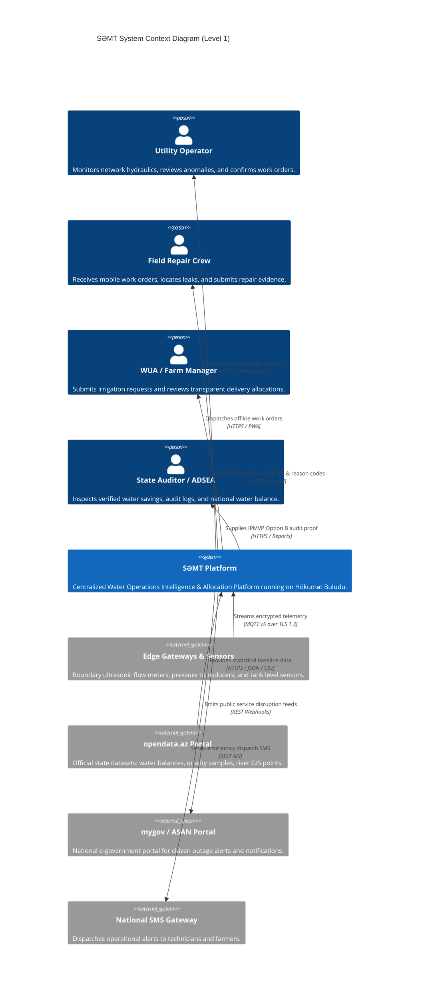
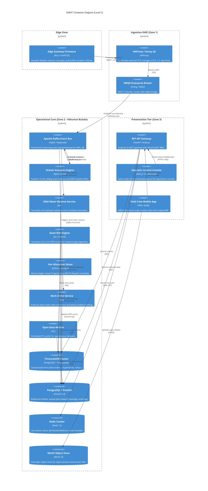
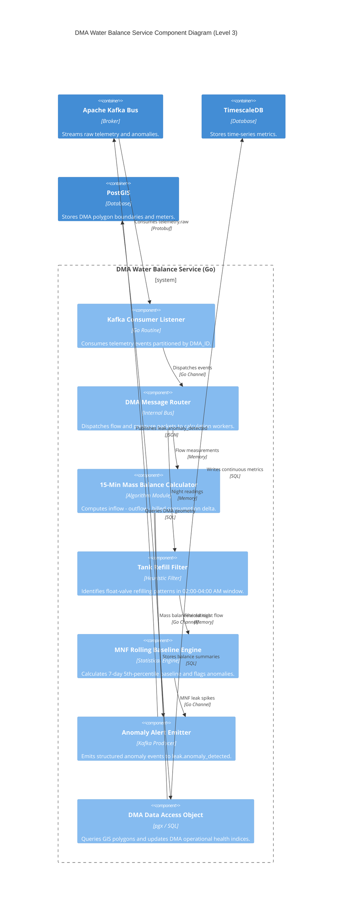
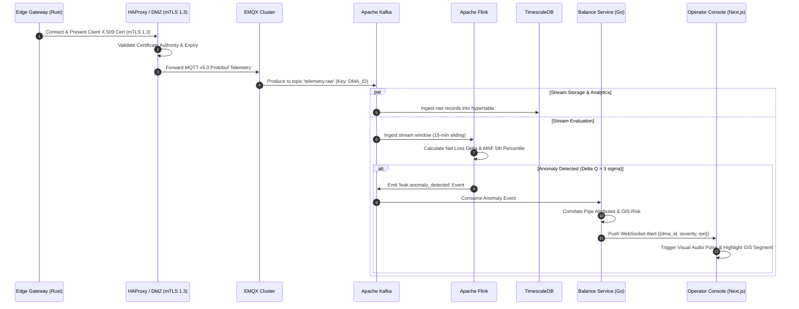
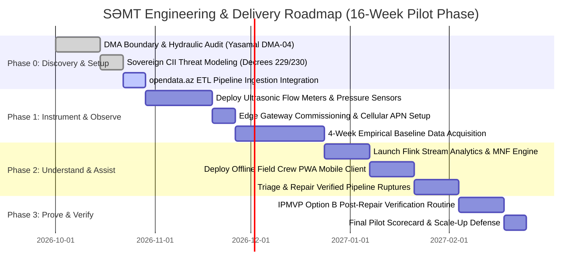

# SƏMT — SU ƏMƏLİYYATLARININ MƏRKƏZLƏŞDİRİLMİŞ TƏHLİLİ
## Centralized Water Operations Intelligence & Allocation Platform
### System Design & Technical Specification — Version 1.0.1 (Milestone 2 Architecture)

**Document Reference:** `SAMT-SYS-SPEC-2026-V1.0.1`  
**Classification:** Sovereign Critical Information Infrastructure (CII) Technical Specification  
**Course:** System Design (PJBL & Flipped Classroom), 4th Year Undergraduate  
**Academic Institution:** Azerbaijan State University of Economics (UNEC)  
**Faculty:** Digital Economy | **Department:** Digital Technologies and Applied Informatics  
**Group:** 550RI-I | **Team:** Team Səmt  
**Lead Author / Student:** Elmaddin Mohubbatov  
**Course Instructor:** Fidan Asgarova  
**Governing Stakeholders:** Azerbaijan State Water Resources Agency (ADSEA) / United Water Supply Service of Large Cities / Innovation and Digital Development Agency (IRIA) / AzInTelecom / XRİTDX  
**Date of Release:** October 26, 2026  
**Status:** Approved Architectural Baseline (Milestone 2: Architectural Modeling, Contracts & Schemas)

---

## Table of Contents
1. [Executive Summary & System Vision](#1-executive-summary--system-vision)
2. [Problem Statement & Azerbaijan Localized Context](#2-problem-statement--azerbaijan-localized-context)
3. [Domain-Driven Design (DDD) Subdomain Decomposition](#3-domain-driven-design-ddd-subdomain-decomposition)
4. [National Open Data Integration (opendata.az)](#4-national-open-data-integration-opendataaz)
5. [Capacity Planning & Back-of-the-Envelope Estimations](#5-capacity-planning--back-of-the-envelope-estimations)
6. [Comprehensive Requirements Engineering (FR & NFR)](#6-comprehensive-requirements-engineering-fr--nfr)
7. [C4 Architectural Model & System Abstractions](#7-c4-architectural-model--system-abstractions)
8. [API Contracts & Interface Specifications (REST & gRPC)](#8-api-contracts--interface-specifications-rest--grpc)
9. [Database Architecture & Data Modeling (SQL vs. NoSQL)](#9-database-architecture--data-modeling-sql-vs-nosql)
10. [Design for Modifiability & Hexagonal Architecture](#10-design-for-modifiability--hexagonal-architecture-applying-lecture-4)
11. [Design for Testability & Verification Architecture](#11-design-for-testability--verification-architecture-applying-lecture-5)
12. [Scalability, Load Balancing & Distributed Data Strategies](#12-scalability-load-balancing--distributed-data-strategies)
13. [Asynchronous Processing & Event-Driven Stream Architecture](#13-asynchronous-processing--event-driven-stream-architecture)
14. [Sovereign Security, Critical Infrastructure Defense & Fault Tolerance](#14-sovereign-security-critical-infrastructure-defense--fault-tolerance)
15. [Mathematical Proofs & Algorithmic Formulations](#15-mathematical-proofs--algorithmic-formulations)
16. [UI/UX Architecture & Prototype Specifications](#16-uiux-architecture--prototype-specifications)
17. [Pilot Implementation Scope, M&V Protocol & Oral Defense Matrix](#17-pilot-implementation-scope-mv-protocol--oral-defense-matrix)
18. [Academic Governance, AI Use Log & Peer Collaboration](#18-academic-governance-ai-use-log--peer-collaboration)

---

## 1. Executive Summary & System Vision

### 1.1 Core Mission & Architectural Mandate
**SƏMT** (*Su Əməliyyatlarının Mərkəzləşdirilmiş Təhlili* — Centralized Analysis of Water Operations) is an enterprise distributed system engineered to modernize Azerbaijan's municipal and agricultural water distribution networks. Built around a closed operational feedback loop — **Sense → Understand → Act → Prove** — SƏMT establishes an unbroken engineering chain connecting low-power field edge telemetry directly to real-time hydraulic mass balancing, algorithmic Minimum Night Flow (MNF) leak localization, predictive pipeline failure risk indexing, dispatchable field crew work orders, and mathematically auditable water allocation schedules.

```
       ┌───────────┐
       │   SENSE   │ Boundary flow, pressure transducers, tank levels, opendata.az
       └─────┬─────┘
             │
             ▼
       ┌───────────┐
       │ UNDERSTAND│ 15-min DMA balance, 02:00-04:00 AM MNF, LoF x CoF risk scoring
       └─────┬─────┘
             │
             ▼
       ┌───────────┐
       │    ACT    │ Ranked repair queue, offline PWA dispatch, MILP canal scheduler
       └─────┬─────┘
             │
             ▼
       ┌───────────┐
       │   PROVE   │ Pre/post-repair IPMVP Option B verification, verified m³ saved
       └─────┬─────┘
             │
             └────────── Continuous baseline calibration loop
```

### 1.2 Operational Stance: Operating Behind the Form
A fundamental architectural tenet established during Phase 1 consultations (under the guidance of Course Instructor Ms. Fidan Asgarova) is the strict demarcation between citizen-facing administrative portals and operational infrastructure intelligence:
* Administrative portals such as `mygov` digitize paperwork, monthly bill payments, and citizen complaints.
* SƏMT functions as the **operational nervous system operating behind `mygov`**. It operates inside the physical network topology, ingesting high-frequency telemetry from District Metered Areas (DMAs), detecting hidden subsurface ruptures before surface surfacing, and calculating fair agricultural distribution quotas based on empirical water availability.

```
  CITIZEN TIER (Existing)                     SƏMT OPERATIONAL TIER (The Core System)
┌───────────────────────────┐                ┌───────────────────────────────────────┐
│ mygov / ASAN Portal       │                │ SƏMT Core Operations Engine           │
│ - Bill payments           │◄── Alert feed ──│ - 15-min DMA Mass Balance             │
│ - Service applications    │    (Webhooks/  │ - 02:00-04:00 AM MNF Leak Localization│
│ - Static citizen reports  │    Kafka)      │ - Asset Risk Index (LoF x CoF)        │
└───────────────────────────┘                │ - MILP Fair Allocation Scheduler      │
                                             │ - Offline PWA Crew Work Orders        │
                                             │ - IPMVP Option B Savings Verification │
                                             └───────────────────────────────────────┘
```

---

## 2. Problem Statement & Azerbaijan Localized Context

### 2.1 The Core Contradiction
Azerbaijan exhibits a severe civil infrastructure paradox:
* **High Nominal Access (On Paper):** Official national figures report approximately **~95% access to improved drinking water sources**.
* **High Physical Loss (In Network):** Real Non-Revenue Water (NRW) physical losses stand at **~28%** nationally (among the highest in the CIS region), while distribution mains in localized sectors of **Greater Baku (Absheron peninsula) suffer physical losses reaching up to 55%**.
* **Distribution Bottleneck:** Azerbaijan's water crisis is not primarily an absence of bulk treated water at major headworks (such as the Jeyranbatan Ultrafiltration Complex, Shamkir Reservoir, or Takhtakorpu Reservoir). Rather, treated water is lost through aged, unmonitored Soviet-era cast-iron and asbestos-cement pipelines before reaching household meters.

### 2.2 Climate, Agricultural & National Security Dimensions
1. **Drought Acceleration:** The agricultural land surface afflicted by severe drought expanded by **2.6× in three years**, jumping from **68,600 hectares in 2020** to **178,300 hectares in 2023** across the Kura-Aras lowland.
2. **Economic Vulnerability:** Approximately **53% of Azerbaijan's GDP** resides in water-dependent sectors (agriculture, chemical processing, oil refining, food manufacturing, thermal energy generation).
3. **Transboundary Reliance:** Over **70% of surface freshwater** originates outside the national borders (Georgia, Armenia, Turkey, Iran, Russia), making internal distribution efficiency a cornerstone of national sovereignty.
4. **Strategic 2040 Vision:** Presidential decrees establishing the Azerbaijan State Water Resources Agency (ADSEA) mandate universal digital metering, automated monitoring, and data-driven allocation frameworks targeting full modernization by **2040**.

### 2.3 The Localized Greater Baku Phenomenon: Rooftop Storage Tanks (*Su Çənləri*)
A critical localized operational condition identified in Report 1 is the prevalence of private rooftop and courtyard water tanks (*su çənləri*) across Greater Baku:
* Due to historical intermittent supply schedules, thousands of residential buildings rely on elevated gravity tanks equipped with mechanical float valves.
* When mains pressure increases during low-demand night hours (02:00–04:00 AM), hundreds of float valves simultaneously open to refill tanks.
* **Standard European MNF algorithms misidentify this legitimate tank refilling as severe pipe bursts.**
* SƏMT's leak localization engine explicitly incorporates an empirical **Tank Refill Inflow Filter**, decoupling hydraulic refill transients from true subsurface pipe bursts.

---

## 3. Domain-Driven Design (DDD) Subdomain Decomposition

SƏMT applies Domain-Driven Design (DDD) to isolate complex water distribution logic into clearly defined Bounded Contexts.

```
┌──────────────────────────────────────────────────────────────────────────────────┐
│                                   SƏMT SYSTEM                                    │
├──────────────────────────────────────────────────────────────────────────────────┤
│ CORE SUBDOMAINS (High Business Value & Competitive Advantage)                    │
│  ├─ 1. DMA Water Balance & Leak Localization: Inflow - Outflow mass balance,     │
│  │     Minimum Night Flow (MNF 02:00-04:00 AM), 50 Hz acoustic & pressure bursts│
│  └─ 2. Equitable Multi-Criteria Allocation Engine: Mixed-Integer Linear          │
│        Programming (MILP) fair dispatch for canal irrigation and water tankers    │
├──────────────────────────────────────────────────────────────────────────────────┤
│ SUPPORTING SUBDOMAINS (Essential Supporting Capabilities)                        │
│  ├─ 3. Asset Failure Risk Index: Likelihood x Consequence (LoF x CoF) pipe rating│
│  ├─ 4. Field Work Orders & M&V: Offline PWA dispatch, photo evidence, M&V audit  │
│  └─ 5. Open Data Harmonizer: opendata.az baseline ingestion & cross-calibration  │
├──────────────────────────────────────────────────────────────────────────────────┤
│ GENERIC SUBDOMAINS (Standard Infrastructure)                                     │
│  ├─ 6. IoT Device Identity & PKI: mTLS 1.3, X.509 certs, battery telemetry       │
│  ├─ 7. Sovereign Security & CII Audit: RBAC, immutable tamper logs (Decree 229)   │
│  └─ 8. Notification Gateway: SMS, USSD, and e-government dispatch adapters       │
└──────────────────────────────────────────────────────────────────────────────────┘
```

### 3.1 Ubiquitous Language Dictionary
* **District Metered Area (DMA):** A hydraulically isolated sector of the water distribution network where water entering and leaving is measured by boundary meters.
* **Minimum Night Flow (MNF):** The lowest recorded flow rate in a DMA, typically occurring between 02:00 and 04:00 AM, representing the sum of legitimate night use and background physical losses.
* **Unavoidable Annual Real Losses (UARL):** Theoretical baseline physical loss volume below which active repair is technically and economically unfeasible.
* **Water User Association (WUA / SİB):** Agricultural co-operative managing secondary and tertiary irrigation canals.
* **Reason Code:** A standardized, immutable alphanumeric identifier appended to every allocation decision explaining the mathematical and policy justification.
* **IPMVP Option B:** International Performance Measurement and Verification Protocol (Option B: Energy/Water Conservation Isolation), measuring baseline vs. post-repair flows under normalized pressure conditions.

---

## 4. National Open Data Integration (opendata.az)

SƏMT anchors its calculations in empirical state data published by the Open Data Portal of the Republic of Azerbaijan (`opendata.az`).

```
                      opendata.az (Azerbaijan Open Data Portal)
                                         │
       ┌──────────────────┬──────────────┴─────┬─────────────────┐
       ▼                  ▼                    ▼                 ▼
┌──────────────┐   ┌──────────────┐     ┌──────────────┐  ┌──────────────┐
│Dataset 1     │   │Dataset 2     │     │Dataset 3     │  │Dataset 4     │
│Su resursları │   │Suyun         │     │Monitorinq    │  │Suvarılan     │
│və istifadə   │   │keyfiyyəti    │     │nöqtələri     │  │torpaqlar &   │
│(Stat. Kom.)  │   │(Birləşmiş Su)│     │(ADSEA)       │  │Su təchizatı  │
└──────┬───────┘   └──────┬───────┘     └──────┬───────┘  └──────┬───────┘
       │                  │                    │                 │
       ▼                  ▼                    ▼                 ▼
Macro Loss Bal.    Cross-Contam. Alert  Intake Boundaries  Fair Allocation
(Top-down audit)   (Chlorine/Turbidity) (Kura/Aras/Samur)  (District Quotas)
```

| Dataset Identifier | Publishing Agency | Ingestion Schedule & Format | Parameters Utilized | SƏMT Functional Purpose |
|---|---|---|---|---|
| **`Su resursları və onlardan istifadə edilməsi`** (Dataset 1) | State Statistical Committee (*Dövlət Statistika Komitəsi*) | Annual historical (2015–2024); JSON/CSV | - Total natural freshwater abstraction ($10^6\text{ m}^3$)<br>- Municipal consumption<br>- Transmission loss (*nəql edilərkən itən su*) | **Macro Water Balance:** Calibrates top-down national losses against bottom-up aggregated DMA balances. |
| **`Suyun keyfiyyəti - Mərkəzi laboratoriya`** (Dataset 2) | United Water Supply Service of Large Cities / ADSEA | Weekly CSV/XLS aggregation | - Residual chlorine ($mg/L$)<br>- Turbidity (NTU)<br>- Total dissolved solids (TDS)<br>- Bacteriological counts | **Contaminant Ingress Warning:** Correlates hydraulic pressure drops with chlorine dilution to flag potential pipe breach cross-contamination. |
| **`Monitorinq nöqtələri`** (Dataset 3) | ADSEA Water Monitoring Sector | Static GIS GeoJSON/CSV | - Observation stations (Kura, Aras, Samur)<br>- WGS84 Lat/Long coordinates<br>- Background (*f/k*) & Control (*n/k*) sections | **Hydraulic Boundary Ingestion:** Supplies intake conditions for main aqueducts feeding Baku water treatment plants. |
| **`Su təchizatı` & `Suvarılan torpaqlar`** (Dataset 4) | State Statistical Committee & Ministry of Agriculture | Annual regional CSV | - Irrigated agricultural land by district (ha)<br>- Network pipeline length (km)<br>- Population served | **Equitable Allocation Engine:** Feeds baseline district demand quotas ($m^3/\text{ha}$) and establishes drought penalty weights. |

---

## 5. Capacity Planning & Back-of-the-Envelope Estimations

To guarantee system stability from initial deployment to nationwide roll-out, capacity planning is modeled across three scaling stages:

```
+---------------------------------------------------------------------------------------------+
|                                  SƏMT CAPACITY SCALING MODEL                                |
+--------------------------+-----------------------+--------------------+---------------------+
| Dimension                | Phase 1: Pilot (1 DMA)| Phase 2: Baku (150)| Phase 3: Nation (Full)
+--------------------------+-----------------------+--------------------+---------------------+
| Bounded Geographic Scope | 1 Baku DMA (Yasamal)  | Greater Baku       | 500 DMAs + Canals   |
| Boundary Flow Meters     | 4 meters              | 600 meters         | 2,000 meters        |
| Dynamic Pressure Sensors | 16 sensors            | 2,400 sensors      | 8,000 sensors       |
| Canal Level/Gate Nodes   | 0 nodes               | 100 nodes          | 20,000 nodes        |
| Smart Bulk/Billing Meter | 1,500 meters          | 50,000 meters      | 250,000 meters      |
| Total Active Endpoints   | 1,520 devices         | 53,100 devices     | 280,000 devices     |
| Sustained Ingestion Rate | ~5 packets/sec        | ~580 packets/sec   | ~302.7 packets/sec  |
| Event Unpacking Rate     | ~20 events/sec        | ~1,200 events/sec  | ~5,800 events/sec   |
| Peak Burst Transient Rate| ~50 events/sec        | ~3,500 events/sec  | ~40,300 events/sec  |
| Daily Raw Ingest Volume  | ~0.04 GB / day        | ~4.8 GB / day      | ~48.1 GB / day      |
| TimescaleDB Compressed/Yr| ~1.4 GB / year        | ~175 GB / year     | ~1.23 TB / year     |
| Network Bandwidth Req.   | Negligible            | ~4.5 KB/sec        | ~29.1 KB/sec (0.23M)|
+--------------------------+-----------------------+--------------------+---------------------+
```

### 5.1 Ingestion Throughput Calculations (National Scale)
* **Boundary Inflow/Outflow Meters:** 2,000 devices reporting 1 packet/minute (4 readings/packet at 15s intervals):
  $$\text{RPS}_{\text{flow}} = \frac{2,000}{60} \approx 33.3\text{ packets/s (133.3 readings/s)}$$
* **Dynamic Pressure Transducers (Normal):** 8,000 devices reporting 1 packet/minute:
  $$\text{RPS}_{\text{pressure}} = \frac{8,000}{60} \approx 133.3\text{ packets/s (133.3 readings/s)}$$
* **Irrigation Canal Level Sensors:** 20,000 devices reporting 1 packet every 5 minutes (300 s):
  $$\text{RPS}_{\text{canals}} = \frac{20,000}{300} \approx 66.7\text{ packets/s (66.7 readings/s)}$$
* **Smart Bulk Billing Meters:** 250,000 devices reporting 1 packet/hour (3,600 s):
  $$\text{RPS}_{\text{smart}} = \frac{250,000}{3,600} \approx 69.4\text{ packets/s (69.4 readings/s)}$$
* **Total Sustained Ingestion Rate:**
  $$\text{RPS}_{\text{sustained}} = 33.3 + 133.3 + 66.7 + 69.4 \approx 302.7\text{ packets/sec}$$
  $$\text{Events}_{\text{unpacked}} = 133.3 + 133.3 + 66.7 + 69.4 \approx 402.7\text{ high-level events/sec} \rightarrow \approx 5,800\text{ raw metrics/sec}$$
* **Transient Burst Load (Water Hammer Shockwave):** If 10% of pressure sensors (800 devices) detect an abrupt hydraulic shock ($dP/dt > 1.5\text{ bar/s}$) and switch into 50 Hz burst mode for 60 seconds:
  $$\text{Burst Influx} = 800 \times 50\text{ Hz} = 40,000\text{ events/sec}$$
  $$\text{Peak Ingestion Capacity Target} = 302.7 + 40,000 \approx 40,300\text{ events/sec}$$

### 5.2 Storage Footprint & Compression Mathematics
* **Wire Protocol Format:** Protocol Buffers v3 encoded payload = 96 bytes average per reading.
* **Network Bandwidth:** $302.7 \times 96\text{ bytes} \approx 29.1\text{ KB/sec} \approx 0.23\text{ Mbps}$ (exceptionally lightweight for cellular carriers).
* **Daily Raw Telemetry Volume:**
  $$\text{Daily Events} = 5,800\text{ events/sec} \times 86,400\text{ sec} = 501,120,000\text{ events/day}$$
  $$\text{Raw Uncompressed Size} = 501.12 \times 10^6 \times 96\text{ bytes} \approx 48.1\text{ GB/day}$$
* **TimescaleDB Columnar Compression:** TimescaleDB hypertables achieve a **93% compression ratio** using Gorilla compression for timestamps/floats and dictionary encoding for device IDs:
  $$\text{Compressed Daily Storage} = 48.1\text{ GB} \times (1 - 0.93) \approx 3.37\text{ GB/day}$$
  $$\text{Annual Storage Required} = 3.37\text{ GB} \times 365 \approx 1.23\text{ TB/year}$$

---

## 6. Comprehensive Requirements Engineering (FR & NFR)

### 6.1 Functional Requirements (FR)
* **`FR-01: Cryptographic Device Ingestion`** — The system must validate edge gateway identities via X.509 client certificates over mTLS 1.3, rejecting packets with invalid signatures, revoked certificates, or clock drift exceeding 15 minutes.
* **`FR-02: Automated DMA Mass Balance`** — The system must calculate the net hydraulic volume balance for every defined DMA polygon on 15-minute sliding windows:
  $$\Delta V(t) = \sum V_{\text{inlets}}(t) - \sum V_{\text{outlets}}(t) - \sum V_{\text{metered}}(t)$$
* **`FR-03: Minimum Night Flow (MNF) Decomposition`** — The system must isolate 02:00–04:00 AM flow data, apply a dynamic 7-day 5th-percentile filter, correct for residential water tank refill patterns, and calculate real background loss.
* **`FR-04: Hydraulic Transient & Rupture Alerting`** — The system must flag sudden pressure differentials ($dP/dt > 1.5\text{ bar/s}$) and emit high-priority rupture events into the Kafka message stream within 2.0 seconds.
* **`FR-05: GIS Asset Risk Scoring`** — The system must compute the Risk Priority Number ($\text{RPN} = \text{LoF} \times \text{CoF}$) for all pipeline segments in the PostGIS database based on installation era, material, soil corrosivity, and burst history.
* **`FR-06: Closed-Loop Work Order Lifecycle`** — The system must enforce an immutable work order state machine: `DETECTED` $\rightarrow$ `CONFIRMED` $\rightarrow$ `DISPATCHED` $\rightarrow$ `EXCAVATED` $\rightarrow$ `REPAIRED` $\rightarrow$ `VERIFIED`. Transitioning to `REPAIRED` strictly mandates geotagged photographic proof and technician sign-off.
* **`FR-07: Multi-Criteria Fair Allocation Optimizer`** — The system must compute constrained delivery schedules for agricultural canals and emergency municipal tankers via Mixed-Integer Linear Programming (MILP), prioritizing crop wilting vulnerability, time since last irrigation, and human survival minimums ($50\text{ L/capita/day}$).
* **`FR-08: Reason-Coded Decision Ledger`** — Every allocation schedule must emit an explicit, machine-readable reason code (e.g., `ALLOC_PRIORITY_CROP_CRITICAL`, `ALLOC_DEFERRED_EXCESS_QUOTA`). Operator overrides must mandate a cryptographically signed justification.
* **`FR-09: opendata.az Ingestion & Calibration`** — The system must run automated daily ETL jobs against `opendata.az` to ingest macro water abstractions, water quality metrics, and monitoring points, logging checksums for data provenance.
* **`FR-10: IPMVP Option B Water Savings Verification`** — Following leak repairs, the system must execute an automated 14-day post-repair verification routine, normalizing for pressure differentials to compute verified physical cubic meters saved.
* **`FR-11: Offline-First Field Synchronization`** — The field crew PWA must operate completely offline in concrete utility vaults, queueing edits in IndexedDB and syncing conflict-free via timestamped reconciliation upon reconnection.
* **`FR-12: Multilingual Sovereign UI`** — The operator console and field interfaces must natively support Azerbaijani as the primary sovereign language, with English available as an administrative secondary language.

### 6.2 Non-Functional Requirements (NFR)
* **`NFR-01: Ingestion-to-Screen Latency`** — P95 latency from sensor edge transmission to live visualization on the operator console must not exceed **2.0 seconds**.
* **`NFR-02: High Availability & Uptime`** — The core telemetry ingestion and stream processing tier must maintain $\ge \mathbf{99.9\%}$ annual availability ($<8.76$ hours unplanned downtime/year).
* **`NFR-03: Edge Autonomy & Buffering`** — Edge gateways must provide local non-volatile storage capable of buffering at least **72 hours** of telemetry during cellular network blackouts.
* **`NFR-04: Zero Data Loss Ingestion`** — Telemetry ingestion must enforce at-least-once message delivery with strict consumer idempotency based on `(device_id, timestamp)` composite keys.
* **`NFR-05: Sovereign Critical Infrastructure (CII) Compliance`** — The system must comply with Azerbaijani Cabinet of Ministers Decrees No. 229 & 230 (2023). All primary data must reside within the physical borders of Azerbaijan on the Government Cloud (*Hökumət Buludu* / AzInTelecom).
* **`NFR-06: Zero-Trust Security & RBAC`** — Strict role-based access control must segregate Operator, Field Technician, Dispatcher, and Auditor roles, maintaining an immutable 10-year audit trail.
* **`NFR-07: Linear Scalability`** — System ingestion and processing capacity must scale horizontally from 1 DMA to 500+ DMAs without schema modifications or architectural rewrites.
* **`NFR-08: Tiered Time-Series Data Retention`** — Raw 1-second telemetry retained for 90 days; 15-minute rollups retained indefinitely; daily aggregated summaries retained for at least 10 years.
* **`NFR-09: Cyber-Physical Air-Gap Safety`** — The MVP enforces a **Read-Only Telemetry Architecture**. No automated cloud control of physical motorized valves or canal sluice gates is permitted.
* **`NFR-10: Open Interoperability Standards`** — Service endpoints must adhere to OpenAPI 3.0, gRPC Protobuf v3, and OGC-compliant (WMS/WFS) geospatial standards for seamless e-government integration.
* **`NFR-11: Disaster Recovery Objectives`** — Telemetry RPO $<1\text{ minute}$; transaction/audit log RPO $= 0\text{ seconds}$; automated cross-datacenter failover RTO $<15\text{ minutes}$ (Baku to Yevlakh).
* **`NFR-12: Mobile Field Resource Footprint`** — The field crew PWA bundle must not exceed 5 MB in size and must initialize within 1.5 seconds on low-cost Android mobile hardware.

---

## 7. C4 Architectural Model & System Abstractions

### 7.1 C4 Level 1: System Context Diagram



### 7.2 C4 Level 2: Container Diagram



### 7.3 C4 Level 3: Component Diagram (Core DMA Water Balance Engine)



### 7.4 UML Sequence Diagram: Telemetry Ingestion to Leak Alerting



---


### 7.5 UML State Machine: Physical Leak Incident Lifecycle
Grounded in Lecture 2 (Behavioral Modeling & State Machines), the lifecycle of a detected physical leak transition is modeled deterministically to prevent state confusion and maintain operational verifiability:

```mermaid
stateDiagram-v2
    [*] --> Detected: Flink flags MNF Delta Q > 3 sigma
    
    Detected --> Assigned: Work order generated; crew dispatched
    Detected --> FalseAlarm: Secondary review confirms rooftop tank refill
    
    Assigned --> InRepair: Crew checks in at GPS coordinate with PWA
    
    InRepair --> Repaired: Pipe clamp / replacement welded; photo uploaded
    
    Repaired --> Verified: IPMVP Option B confirms post-repair MNF drop
    Repaired --> InRepair: Post-repair night flow fails verification (leak persists)
    
    Verified --> Closed: ADSEA audit sign-off; m³ water saved logged
    FalseAlarm --> Closed: Logged as anomalous legitimate draw
    Closed --> [*]
```



---

## 8. API Contracts & Interface Specifications (REST & gRPC)

### 8.0 Design by Contract (DbC) Formal Specification Matrix
In strict adherence to Lecture 3 (*Designing Interface Specifications*), all primary API endpoints are governed by explicit mathematical contracts:

| Operation & Protocol | Preconditions (`requires`) | Postconditions (`ensures`) | Exceptional Exits (`throws`) |
|---|---|---|---|
| **POST `/telemetry/batch`**<br>*(REST / JSON)* | • Caller presents valid X.509 client certificate.<br>• $1 \le 	ext{len(measurements)} \le 60$.<br>• $|t_{	ext{batch}} - t_{	ext{server}}| \le 15	ext{ min}$. | • Returns HTTP 202 Accepted.<br>• Generates unique correlation ID.<br>• Emits event to Kafka topic `telemetry.raw`. | • `400 Bad Request`: Clock drift $>15	ext{ min}$ or schema invalid.<br>• `401 Unauthorized`: Bad mTLS cert.<br>• `429 Too Many Requests`: Rate limit exceeded. |
| **GET `/dma/{id}/balance`**<br>*(REST / JSON)* | • `dma_id` exists in `dma_zones`.<br>• $1 \le 	ext{window\_hours} \le 720$. | • Returns computed net loss $m^3/h$, loss %, and status flag in $<350	ext{ ms}$ (P95).<br>• Real-time cache updated in Redis. | • `404 Not Found`: Unknown `dma_id`.<br>• `503 Service Unavailable`: Storage read replica lag $>60	ext{ s}$. |
| **POST `/allocation/solve`**<br>*(REST / JSON)* | • Total available water volume $V_{	ext{avail}} > 0$.<br>• Active agricultural requests $\ge 1$. | • Generates optimal allocation satisfying human basic needs ($50	ext{ L/cap/day}$) before canal deliveries.<br>• Machine-readable reason code emitted. | • `422 Unprocessable`: Infeasible constraint matrix.<br>• `504 Gateway Timeout`: Solver exceeds $5.0	ext{ s}$ execution ceiling. |
| **IngestTelemetryStream**<br>*(gRPC / Protobuf v3)* | • TLS 1.3 session established.<br>• Monotonically increasing sequence ID.<br>• Binary packet size $<120	ext{ bytes}$. | • Server returns `IngestStreamResponse` with `ack_sequence`.<br>• Zero in-memory buffer drop. | • `UNAUTHENTICATED`: Expired client certificate.<br>• `RESOURCE_EXHAUSTED`: Client rate $>250	ext{ pkts/s}$. |


### 8.1 OpenAPI 3.0 REST Specification (Extract)
```yaml
openapi: 3.0.3
info:
  title: SƏMT Core Operations API
  description: Operational telemetry, hydraulic mass balance, work order management, and allocation services.
  version: 1.0.0
servers:
  - url: https://api.semt.gov.az/v1
    description: Hökumət Buludu Production API Gateway
paths:
  /telemetry/batch:
    post:
      summary: Ingest batched edge sensor readings
      operationId: ingestTelemetryBatch
      security:
        - MutualTLS: []
        - BearerAuth: []
      requestBody:
        required: true
        content:
          application/json:
            schema:
              $ref: '#/components/schemas/TelemetryBatchRequest'
      responses:
        '202':
          description: Telemetry accepted for asynchronous streaming ingestion
          content:
            application/json:
              schema:
                $ref: '#/components/schemas/BatchIngestResponse'
        '400':
          description: Invalid payload or timestamp clock drift >15 minutes
        '401':
          description: Unauthorized client certificate or token
  /dma/{dma_id}/balance:
    get:
      summary: Retrieve real-time 15-minute mass balance for a DMA
      operationId: getDmaMassBalance
      parameters:
        - name: dma_id
          in: path
          required: true
          schema:
            type: string
            example: "DMA-YASAMAL-04"
        - name: window_hours
          in: query
          schema:
            type: integer
            default: 24
      responses:
        '200':
          description: Successful balance calculation
          content:
            application/json:
              schema:
                $ref: '#/components/schemas/DmaBalanceResponse'
  /allocation/solve:
    post:
      summary: Execute Mixed-Integer Linear Programming (MILP) fair allocation schedule
      operationId: solveAllocationSchedule
      security:
        - BearerAuth: []
      requestBody:
        required: true
        content:
          application/json:
            schema:
              $ref: '#/components/schemas/AllocationSolveRequest'
      responses:
        '200':
          description: Optimal allocation schedule generated with reason codes
          content:
            application/json:
              schema:
                $ref: '#/components/schemas/AllocationSolveResponse'
components:
  schemas:
    TelemetryBatchRequest:
      type: object
      required:
        - gateway_id
        - batch_timestamp
        - measurements
      properties:
        gateway_id:
          type: string
          example: "GW-AZ-BAKU-YAS-008"
        batch_timestamp:
          type: string
          format: date-time
        measurements:
          type: array
          items:
            $ref: '#/components/schemas/SensorMeasurement'
    SensorMeasurement:
      type: object
      required:
        - sensor_id
        - timestamp
        - metric_type
        - value
      properties:
        sensor_id:
          type: string
          example: "FM-INLET-01"
        timestamp:
          type: string
          format: date-time
        metric_type:
          type: string
          enum: [FLOW_M3H, PRESSURE_BAR, LEVEL_METERS, CHLORINE_MG_L, TURBIDITY_NTU]
        value:
          type: number
          format: double
          example: 48.75
    BatchIngestResponse:
      type: object
      properties:
        status:
          type: string
          example: "ACCEPTED"
        ingested_count:
          type: integer
          example: 16
        correlation_id:
          type: string
          example: "cor-20261013-98741"
    DmaBalanceResponse:
      type: object
      properties:
        dma_id:
          type: string
        calculation_timestamp:
          type: string
          format: date-time
        inflow_m3h:
          type: number
        outflow_m3h:
          type: number
        net_loss_m3h:
          type: number
        loss_percentage:
          type: number
          example: 32.4
        current_mnf_m3h:
          type: number
          example: 18.2
        baseline_mnf_m3h:
          type: number
          example: 12.1
        status:
          type: string
          enum: [NORMAL, ELEVATED_LOSS, CRITICAL_BURST]
    AllocationSolveRequest:
      type: object
      required:
        - region_id
        - available_water_m3
        - canal_network_id
      properties:
        region_id:
          type: string
          example: "REG-KUR-ARAS-03"
        available_water_m3:
          type: number
          example: 50000.0
        time_horizon_hours:
          type: integer
          default: 72
    AllocationSolveResponse:
      type: object
      properties:
        solver_status:
          type: string
          example: "OPTIMAL"
        computed_at:
          type: string
          format: date-time
        total_allocated_m3:
          type: number
          example: 48500.0
        schedules:
          type: array
          items:
            type: object
            properties:
              consumer_id:
                type: string
                example: "WUA-SABIRABAD-02"
              allocated_volume_m3:
                type: number
                example: 12400.0
              scheduled_window_start:
                type: string
                format: date-time
              reason_code:
                type: string
                example: "ALLOC_PRIORITY_CROP_CRITICAL"
```

### 8.2 gRPC Protocol Buffers v3 Service Definition
```protobuf
syntax = "proto3";

package semt.telemetry.v1;

option go_package = "semt/gen/telemetry/v1;telemetryv1";

service TelemetryIngestionService {
  rpc IngestTelemetryStream (stream IngestStreamRequest) returns (IngestStreamResponse);
  rpc IngestBatch (TelemetryBatch) returns (IngestBatchResponse);
}

enum MetricType {
  METRIC_TYPE_UNSPECIFIED = 0;
  METRIC_TYPE_FLOW_M3H = 1;
  METRIC_TYPE_PRESSURE_BAR = 2;
  METRIC_TYPE_LEVEL_METERS = 3;
  METRIC_TYPE_CHLORINE_MG_L = 4;
  METRIC_TYPE_TURBIDITY_NTU = 5;
}

message MetricRecord {
  string sensor_id = 1;
  int64 timestamp_unix_epoch_ms = 2;
  MetricType metric_type = 3;
  double value = 4;
  uint32 status_flags = 5;
}

message TelemetryBatch {
  string gateway_id = 1;
  int64 gateway_time_unix_ms = 2;
  repeated MetricRecord records = 3;
  bytes cryptographic_signature = 4;
}

message IngestBatchResponse {
  bool success = 1;
  int32 processed_count = 2;
  string error_message = 3;
}

message IngestStreamRequest {
  oneof payload {
    TelemetryBatch batch = 1;
    MetricRecord single_burst = 2;
  }
}

message IngestStreamResponse {
  int64 ack_sequence = 1;
  bool throttle_warning = 2;
}
```

---

## 9. Database Architecture & Data Modeling (SQL vs. NoSQL)

### 9.1 Architectural Evaluation: SQL vs. NoSQL
A major architectural decision evaluated in Report 1 and finalized for SƏMT is the database storage topology:

| Dimension | Option A: Dedicated NoSQL (e.g., InfluxDB + MongoDB) | Option B: Unified Relational + Extensions (TimescaleDB + PostGIS) | Selected Decision & Justification |
|---|---|---|---|
| **Data Integrity & ACID** | Eventual consistency; lacks cross-collection transactions | Full ACID transaction guarantees on work orders and audit logs | **Option B:** Critical water utility operations require strict consistency for work orders and legal audit compliance. |
| **Spatial Network Topology** | Poor spatial joining capability; requires external spatial engine | Gold-standard GIS support with PostGIS geometric routing and spatial joins | **Option B:** Network leak localization requires joining dynamic sensor points directly against pipeline line strings. |
| **Operational Overhead** | Requires managing two distributed database clusters and sync pipelines | Single PostgreSQL engine hosting both hypertables and spatial tables | **Option B:** Eliminates split-brain operational states, lowers infrastructure costs on *Hökumət Buludu*. |
| **Query Flexibility** | Specialized query languages (InfluxQL/Flux); limited join capabilities | Standard ANSI SQL with analytical window functions | **Option B:** Allows utility engineers to run complex analytical SQL joins across hydraulics, assets, and audit logs. |

### 9.2 Complete PostgreSQL 16 + PostGIS + TimescaleDB DDL Schema
```sql
-- Enable necessary sovereign database extensions
CREATE EXTENSION IF NOT EXISTS postgis;
CREATE EXTENSION IF NOT EXISTS timescaledb;
CREATE EXTENSION IF NOT EXISTS "uuid-ossp";

-- 1. District Metered Areas (DMA) Spatial Table
CREATE TABLE dma_zones (
    dma_id VARCHAR(32) PRIMARY KEY,
    name VARCHAR(128) NOT NULL,
    administrative_district VARCHAR(64) NOT NULL, -- e.g., Yasamal, Sabunchu
    polygon_boundary GEOMETRY(Polygon, 4326) NOT NULL,
    estimated_population INTEGER NOT NULL,
    total_pipe_length_km NUMERIC(8, 2) NOT NULL,
    baseline_mnf_m3h NUMERIC(8, 3) DEFAULT 0.0,
    created_at TIMESTAMPTZ DEFAULT NOW(),
    updated_at TIMESTAMPTZ DEFAULT NOW()
);
CREATE INDEX idx_dma_spatial ON dma_zones USING GIST (polygon_boundary);

-- 2. Physical Pipe Network Infrastructure Table
CREATE TABLE pipe_segments (
    segment_id VARCHAR(32) PRIMARY KEY,
    dma_id VARCHAR(32) REFERENCES dma_zones(dma_id),
    material VARCHAR(32) NOT NULL, -- Asbestos-Cement, Cast-Iron, Steel, HDPE
    diameter_mm INTEGER NOT NULL,
    installation_year INTEGER NOT NULL,
    soil_corrosivity VARCHAR(16) NOT NULL, -- LOW, MEDIUM, HIGH (Absheron saline)
    break_history_count INTEGER DEFAULT 0,
    consequence_factor NUMERIC(4, 2) NOT NULL, -- CoF: 1.0 to 10.0
    risk_priority_number NUMERIC(6, 2) DEFAULT 0.0, -- LoF * CoF
    geometry GEOMETRY(LineString, 4326) NOT NULL,
    created_at TIMESTAMPTZ DEFAULT NOW()
);
CREATE INDEX idx_pipe_spatial ON pipe_segments USING GIST (geometry);
CREATE INDEX idx_pipe_dma ON pipe_segments(dma_id);

-- 3. Telemetry Measurements Hypertable (TimescaleDB)
CREATE TABLE telemetry_measurements (
    time TIMESTAMPTZ NOT NULL,
    device_id VARCHAR(32) NOT NULL,
    dma_id VARCHAR(32) NOT NULL,
    metric_type VARCHAR(24) NOT NULL,
    value NUMERIC(10, 4) NOT NULL,
    quality_flag SMALLINT DEFAULT 0 -- 0: Valid, 1: Suspect, 2: Calibrated
);

-- Convert to TimescaleDB Hypertable with 7-day chunk intervals
SELECT create_hypertable('telemetry_measurements', 'time', chunk_time_interval => INTERVAL '7 days');

-- Create composite index for rapid time-slice queries
CREATE INDEX idx_telemetry_device_time ON telemetry_measurements (device_id, time DESC);
CREATE INDEX idx_telemetry_dma_metric_time ON telemetry_measurements (dma_id, metric_type, time DESC);

-- Enable Native Columnar Chunk Compression (Gorilla + Dictionary)
ALTER TABLE telemetry_measurements SET (
    timescaledb.compress,
    timescaledb.compress_segmentby = 'dma_id, metric_type, device_id',
    timescaledb.compress_orderby = 'time DESC'
);

-- Automatically compress chunks older than 3 days
SELECT add_compression_policy('telemetry_measurements', INTERVAL '3 days');

-- Retain raw 1-second data for 90 days
SELECT add_retention_policy('telemetry_measurements', INTERVAL '90 days');


-- 4. Continuous Aggregate View: 15-Minute DMA Water Balance
-- Computes real-time tumbling water balances per DMA directly in storage
CREATE MATERIALIZED VIEW dma_water_balance_15m
WITH (timescaledb.continuous) AS
SELECT 
    dma_id,
    time_bucket(INTERVAL '15 minutes', time) AS bucket,
    AVG(CASE WHEN metric_type = 'PRESSURE_BAR' THEN value END) AS avg_pressure_bar,
    SUM(CASE WHEN metric_type = 'FLOW_INLET_M3H' THEN value * 0.25 END) AS total_inflow_m3,
    SUM(CASE WHEN metric_type = 'FLOW_OUTLET_M3H' THEN value * 0.25 END) AS total_outflow_m3
FROM telemetry_measurements
GROUP BY dma_id, bucket;

-- Configure Continuous Aggregate Refresh Policy (Refreshes every 15 minutes)
SELECT add_continuous_aggregate_policy('dma_water_balance_15m',
    start_offset => INTERVAL '3 days',
    end_offset   => INTERVAL '15 minutes',
    schedule_interval => INTERVAL '15 minutes');

-- 5. PostGIS Hydraulic Network Proximity Query Function
-- Locates all active pipe segments and isolation valves within R meters of a burst transient
CREATE OR REPLACE FUNCTION get_pipes_near_burst(
    burst_lon DOUBLE PRECISION,
    burst_lat DOUBLE PRECISION,
    radius_meters DOUBLE PRECISION
)
RETURNS TABLE (
    segment_id VARCHAR(32),
    material VARCHAR(32),
    diameter_mm INTEGER,
    installation_year INTEGER,
    risk_score NUMERIC(6, 2),
    distance_meters DOUBLE PRECISION
) AS $$
BEGIN
    RETURN QUERY
    SELECT 
        p.segment_id,
        p.material,
        p.diameter_mm,
        p.installation_year,
        p.risk_priority_number,
        ST_Distance(p.geometry::geography, ST_SetSRID(ST_MakePoint(burst_lon, burst_lat), 4326)::geography) AS distance_meters
    FROM pipe_segments p
    WHERE ST_DWithin(p.geometry::geography, ST_SetSRID(ST_MakePoint(burst_lon, burst_lat), 4326)::geography, radius_meters)
    ORDER BY distance_meters ASC;
END;
$$ LANGUAGE plpgsql;

CREATE MATERIALIZED VIEW dma_15min_water_balance
WITH (timescaledb.continuous) AS
SELECT
    time_bucket('15 minutes', time) AS bucket,
    dma_id,
    AVG(CASE WHEN metric_type = 'FLOW_INLET' THEN value ELSE NULL END) AS avg_inflow_m3h,
    AVG(CASE WHEN metric_type = 'FLOW_OUTLET' THEN value ELSE NULL END) AS avg_outflow_m3h,
    AVG(CASE WHEN metric_type = 'PRESSURE_BAR' THEN value ELSE NULL END) AS avg_pressure_bar
FROM telemetry_measurements
GROUP BY bucket, dma_id;

-- 5. Closed-Loop Work Order Lifecycle Table
CREATE TYPE work_order_status AS ENUM (
    'DETECTED', 'CONFIRMED', 'DISPATCHED', 'EXCAVATED', 'REPAIRED', 'VERIFIED', 'CANCELLED'
);

CREATE TABLE work_orders (
    work_order_id UUID PRIMARY KEY DEFAULT uuid_generate_v4(),
    dma_id VARCHAR(32) REFERENCES dma_zones(dma_id),
    pipe_segment_id VARCHAR(32) REFERENCES pipe_segments(segment_id),
    status work_order_status DEFAULT 'DETECTED',
    severity VARCHAR(16) NOT NULL, -- LOW, MEDIUM, CRITICAL, EMERGENCY
    estimated_loss_rate_m3h NUMERIC(8, 2),
    detected_at TIMESTAMPTZ DEFAULT NOW(),
    assigned_crew_id VARCHAR(32),
    repaired_at TIMESTAMPTZ,
    verified_at TIMESTAMPTZ,
    repair_photo_url VARCHAR(256), -- Stored in MinIO
    technician_notes TEXT,
    verified_savings_m3 NUMERIC(10, 2) DEFAULT 0.0
);
CREATE INDEX idx_wo_status ON work_orders(status);
CREATE INDEX idx_wo_dma ON work_orders(dma_id);

-- 6. Equitable Allocation Ledger Table
CREATE TABLE allocation_ledger (
    allocation_id UUID PRIMARY KEY DEFAULT uuid_generate_v4(),
    region_id VARCHAR(32) NOT NULL,
    consumer_entity_id VARCHAR(32) NOT NULL,
    allocated_volume_m3 NUMERIC(10, 2) NOT NULL,
    requested_volume_m3 NUMERIC(10, 2) NOT NULL,
    urgency_score NUMERIC(6, 3) NOT NULL,
    reason_code VARCHAR(32) NOT NULL,
    override_flag BOOLEAN DEFAULT FALSE,
    override_authorizer VARCHAR(64),
    override_justification TEXT,
    created_at TIMESTAMPTZ DEFAULT NOW()
);
CREATE INDEX idx_alloc_region ON allocation_ledger(region_id, created_at DESC);

-- 7. National Open Data Provenance & Lineage Log Table
CREATE TABLE raw_external_dataset_log (
    log_id SERIAL PRIMARY KEY,
    dataset_name VARCHAR(64) NOT NULL,
    source_url VARCHAR(256) NOT NULL,
    sha256_checksum CHAR(64) NOT NULL,
    records_ingested INTEGER NOT NULL,
    ingestion_timestamp TIMESTAMPTZ DEFAULT NOW(),
    status VARCHAR(16) NOT NULL
);
```

---


---

## 10. Design for Modifiability & Hexagonal Architecture (Applying Lecture 4)

### 10.1 Identification & Encapsulation of Parnas Secrets
In strict alignment with David L. Parnas' Information Hiding Principle, SƏMT is decomposed around architectural "secrets" — design decisions that are volatile and likely to evolve:

```
┌────────────────────────────────────────────────────────────────────────┐
│ ARCHITECTURAL SECRET            │ ENCAPSULATING MODULE                 │
├─────────────────────────────────┼──────────────────────────────────────┤
│ 1. Physical Edge Sensor Wiring  │ Edge Gateway Drivers & Adapters      │
│    (Modbus, M-Bus, LoRaWAN)     │ Normalizes raw packets into Protobuf │
├─────────────────────────────────┼──────────────────────────────────────┤
│ 2. Storage Engine Implementation│ Repository Interfaces (Ports)        │
│    (TimescaleDB / PostGIS DDL)  │ Domain queries via abstract interfaces│
├─────────────────────────────────┼──────────────────────────────────────┤
│ 3. Mathematical Allocation Model│ Allocation Solver Adapter            │
│    (Google OR-Tools MILP matrix)│ Pluggable LP/MILP optimization       │
├─────────────────────────────────┼──────────────────────────────────────┤
│ 4. External E-Gov Schemas       │ Open Data & MyGov Gateways           │
│    (opendata.az CSV structures) │ Normalizes external formats into GIS │
└─────────────────────────────────┴──────────────────────────────────────┘
```

### 10.2 Hexagonal Ports & Adapters Architecture
High-level operational policies are completely decoupled from low-level infrastructure mechanisms through the **Dependency Inversion Principle (DIP)**:

```
                          HEXAGONAL ARCHITECTURE
    ┌──────────────────────────────────────────────────────────────────┐
    │ DRIVING ADAPTERS (INBOUND)                                       │
    │   • gRPC Edge Telemetry Controller                               │
    │   • REST API Gateway (Gin / Go)                                  │
    │   • WebSocket Real-Time Alert Hub                                │
    │        │                                                         │
    │        ▼                                                         │
    │ ┌──────────────────────────────────────────────────────────────┐ │
    │ │ INBOUND PORTS (USE CASES)                                    │ │
    │ │   • IIngestTelemetryBatchUseCase                             │ │
    │ │   • ICalculateDmaMassBalanceUseCase                          │ │
    │ │   • ISolveEquitableCanalAllocationUseCase                    │ │
    │ ├──────────────────────────────────────────────────────────────┤ │
    │ │ CORE DOMAIN MODEL (ZERO EXTERNAL DEPENDENCIES)               │ │
    │ │   • Entities: DmaZone, PipeSegment, MeterReading, WorkOrder  │ │
    │ │   • Value Objects: PressureBar, FlowM3H, GeoCoordinates      │ │
    │ │   • Domain Services: MinimumNightFlowFilter, FavadLossModel  │ │
    │ ├──────────────────────────────────────────────────────────────┤ │
    │ │ OUTBOUND PORTS (REPOSITORY & SERVICE INTERFACES)             │ │
    │ │   • ITelemetryRepository                                     │ │
    │ │   • IPipeNetworkSpatialRepository                            │ │
    │ │   • INotificationDispatcherPort                              │ │
    │ └──────────────────────────────────────────────────────────────┘ │
    │        │                                                         │
    │        ▼                                                         │
    │ DRIVEN ADAPTERS (OUTBOUND)                                       │
    │   • TimescaleDB Telemetry Repository                             │
    │   • PostGIS Network Topology Repository                          │
    │   • Apache Kafka Event Publisher                                 │
    │   • Government SMS & MyGov Notification Adapter                  │
    └──────────────────────────────────────────────────────────────────┘
```

---

## 11. Design for Testability & Verification Architecture (Applying Lecture 5)

### 11.1 Controllability & Observability Design
Because physical water networks cannot be easily controlled or observed during software development, SƏMT explicitly engineers test seams:

* **Controllability via Injectable Clock (`IClock`):** Minimum Night Flow (MNF) analysis inspects flow between 02:00 AM and 04:00 AM. Production code uses an injectable clock:
  ```go
  type Clock interface {
      Now() time.Time
  }
  
  type RealSystemClock struct{}
  func (c *RealSystemClock) Now() time.Time { return time.Now().UTC() }
  
  type MockTestClock struct {
      FrozenTime time.Time
  }
  func (c *MockTestClock) Now() time.Time { return c.FrozenTime }
  ```
  This allows automated unit and integration tests to simulate nocturnal leak conditions at any time of day deterministically.

### 11.2 Test Doubles Taxonomy
To enable automated CI testing without physical hardware, SƏMT establishes explicit test doubles:

1. **Synthetic Telemetry Generator (Fake):** A complete physics-based simulator modeling diurnal flow cycles ($Q_{	ext{day}} pprox 3 	imes Q_{	ext{night}}$), Torricelli orifice leaks ($Q = C_d A \sqrt{2gH}$), and water hammer pressure transients.
2. **In-Memory Spatial Topology (Stub):** Implements `IPipeNetworkSpatialRepository` using in-memory R-Tree spatial indexing for fast unit testing.
3. **Audit Log Verifier (Spy):** Records security event invocations and asserts cryptographic HMAC signature validity.

---

## 12. Scalability, Load Balancing & Distributed Data Strategies

### 10.1 Multi-Tier Load Balancing Architecture
To handle sustained ingestion and sudden transient burst loads without single-point failures, SƏMT separates L4 transport balancing from L7 application routing:

```
                          INTERNET / CELLULAR APN
                                     │
                                     ▼
                ┌────────────────────────────────────────┐
                │ L4 Load Balancer: Dual Active-Passive  │
                │ HAProxy (Keepalived VRRP Floating IP)  │
                └───────────────────┬────────────────────┘
                                    │
               ┌────────────────────┴────────────────────┐
               ▼ (Port 8883 - MQTT TLS)                  ▼ (Port 443 - HTTPS)
┌──────────────────────────────┐          ┌──────────────────────────────┐
│ EMQX Broker Cluster          │          │ Envoy L7 Reverse Proxy       │
│ - 3 Nodes (Auto-clustering)  │          │ - WAF & DDoS Shield          │
│ - Hardware mTLS 1.3 Term.    │          │ - Token Bucket Rate Limiting │
│ - In-memory Session State    │          │ - JWT Signature Verification │
└──────────────┬───────────────┘          └──────────────┬───────────────┘
               │                                         │
               ▼                                         ▼
┌──────────────────────────────┐          ┌──────────────────────────────┐
│ Apache Kafka Cluster         │          │ Stateless Go Microservices   │
│ - Partitioned by DMA_ID      │          │ - Horizontal Pod Autoscaler  │
└──────────────────────────────┘          └──────────────────────────────┘
```

1. **L4 Layer (HAProxy Cluster):** Terminated on floating virtual IPs via Keepalived. Distributes raw TCP streams across EMQX MQTT brokers using least-connections balancing.
2. **L7 Layer (Envoy Proxy):** Manages API gateway routing, path-based routing, HTTP/2 to gRPC translation, and mutual TLS inspection for administrative clients.
3. **Stateless Service Tier:** All Go microservices maintain zero local state, delegating persistence to Redis and PostgreSQL. Microservices scale horizontally from 3 to 20 instances via Kubernetes Horizontal Pod Autoscaler (HPA) triggered by CPU utilization ($>70\%$) and Kafka consumer group lag ($>1,000$ records).

### 10.2 Multi-Tier Caching & Invalidation Strategy
```
┌────────────────────────────────────────────────────────────────────────┐
│                        CACHING TOPOLOGY & LIFECYCLE                    │
├────────────────────────────────────────────────────────────────────────┤
│ Layer 1: Edge Gateway Buffer (SQLite WAL Mode, 72-hour TTL)            │
│ Layer 2: Redis Cluster L1 Cache (Sub-second retrieval, Cache-Aside)    │
│ Layer 3: TimescaleDB Continuous Aggregates (15-min, Hourly Pre-computes)│
│ Layer 4: Cloudflare / Sovereign CDN (Static MapLibre Vector PBF Tiles) │
└────────────────────────────────────────────────────────────────────────┘
```

* **Cache-Aside Pattern (Live Hydraulic State):**
  When the operator console requests live DMA telemetry:
  1. The API Gateway queries Redis (`GET dma:{dma_id}:live_state`).
  2. On cache miss, it reads the latest 15-minute continuous aggregate from TimescaleDB, writes the result to Redis with a 30-second TTL, and returns the payload.
* **Write-Through Pattern (Distributed Allocation Locks):**
  When a water allocation transaction is committed, distributed mutex locks (`Redlock`) are written to Redis and mirrored synchronously to the PostgreSQL ledger table.
* **Cache Stampede / Dogpiling Mitigation:**
  To prevent thousands of concurrent requests from overwhelming the database when a popular DMA key expires, SƏMT implements **Probabilistic Early Expiration (XFetch Algorithm)**:
  $$\Delta t \times \beta \times \ln(\text{random}()) > \text{remaining\_ttl}$$
  Where $\beta = 1.0$. The background worker preemptively refreshes the cache before total expiry.

### 10.3 Distributed Data Handling: CAP & PACELC Theorem Matrix
Under the PACELC theorem (If Partition: Availability vs. Consistency; Else: Latency vs. Consistency), SƏMT differentiates operational requirements by subdomain:

| Bounded Context | CAP Classification | PACELC Classification | Architectural Justification |
|---|---|---|---|
| **Telemetry Ingestion Bus (Kafka)** | **AP** (Availability / Partition) | **PA/EL** (Partition $\rightarrow$ Availability, Else $\rightarrow$ Low Latency) | Sensors must never be blocked from transmitting; slight out-of-order arrival is reordered downstream via Flink event-time watermarks. |
| **DMA Mass Balance & MNF (Flink/TSDB)** | **AP** (Eventual Consistency) | **PA/EL** | A 30-second delay in computing a night flow baseline is acceptable; continuous stream availability is paramount. |
| **Work Order Lifecycle (PostgreSQL)** | **CP** (Consistency / Partition) | **PC/EC** (Partition $\rightarrow$ Consistency, Else $\rightarrow$ Strict Consistency) | Excavation crews must never see conflicting or duplicate work orders; ACID transactions strictly enforced. |
| **Fair Allocation Engine (PostGIS/Ledger)** | **CP** (Consistency / Partition) | **PC/EC** | Prevents double-allocation of physical canal quotas during regional network partitions; enforces mathematical equity. |

---

## 13. Asynchronous Processing & Event-Driven Stream Architecture

### 11.1 Apache Kafka Topic Topology & Sharding Keys
Kafka topics are partitioned strictly by `dma_id` or `region_id` to guarantee in-order event sequencing within any given hydraulic zone:

```
┌───────────────────────────┬────────────┬─────────────┬────────────────────────────────┐
│ Topic Name                │ Partitions │ Replication │ Partition Key & Cleanup Policy │
├───────────────────────────┼────────────┼─────────────┼────────────────────────────────┤
│ telemetry.raw             │ 32         │ 3           │ dma_id (Delete, 7-day TTL)     │
│ telemetry.transient.burst │ 16         │ 3           │ sensor_id (Delete, 24-hour TTL)│
│ leak.anomaly_detected     │ 8          │ 3           │ dma_id (Compact & Retain 30d)  │
│ workorder.status_changed  │ 8          │ 3           │ work_order_id (Compact)        │
│ allocation.scheduled      │ 4          │ 3           │ region_id (Compact, 10-yr audit│
└───────────────────────────┴────────────┴─────────────┴────────────────────────────────┘
```

### 11.2 Formal Kafka Event Schemas

#### Event 1: `leak.anomaly_detected`
```json
{
  "$schema": "https://json-schema.org/draft/2020-12/schema",
  "eventId": "evt-88349102-4412",
  "eventType": "LEAK_ANOMALY_DETECTED",
  "timestamp": "2026-10-13T03:14:22.105Z",
  "dmaId": "DMA-YASAMAL-04",
  "detectionEngine": "FLINK_MNF_ANOMALY_V1",
  "severity": "CRITICAL",
  "metrics": {
    "observedFlowM3h": 46.20,
    "expectedBaselineM3h": 14.50,
    "deltaSigma": 4.12,
    "linePressureBar": 3.85,
    "pressureGradientBarSec": -0.85
  },
  "estimatedBurstVolumeM3": 31.70,
  "confidenceScore": 0.94
}
```

#### Event 2: `workorder.status_changed`
```json
{
  "eventId": "evt-99120412-1089",
  "eventType": "WORK_ORDER_STATUS_CHANGED",
  "timestamp": "2026-10-13T08:30:00Z",
  "workOrderId": "wo-e18b8492-990a-4876-b684-183920193821",
  "dmaId": "DMA-YASAMAL-04",
  "previousStatus": "EXCAVATED",
  "newStatus": "REPAIRED",
  "assignedCrewId": "CREW-BAKU-CENTRAL-03",
  "technicianId": "TECH-ELM-881",
  "repairMetadata": {
    "repairMethod": "HDPE_ELECTROFUSION_COUPLER",
    "pipeDiameterMm": 150,
    "geotaggedPhotoUrl": "s3://semt-evidence/2026/10/wo-e18b8492-repair.jpg",
    "photoGpsCoords": {"lat": 40.37891, "lon": 49.81240}
  }
}
```

### 11.3 Apache Flink Stream Processing Topology
Flink operates as the real-time analytical brain of SƏMT, consuming `telemetry.raw` with the following pipeline:
1. **Event-Time Watermarking:** Bounded-out-of-orderness watermarking allowing up to **30 seconds** of cellular network latency.
2. **Keyed Stream Partitioning:** Stream keyed by `dma_id`.
3. **Sliding Window Mass Balance:** 15-minute sliding window evaluated every 1 minute. Sums boundary inflow meters, subtracts boundary outflow meters, and evaluates balance deltas.
4. **Tumbling Night Window (MNF):** 2-hour window covering 02:00–04:00 AM local time. Computes rolling 7-day 5th-percentile minimum flow and applies the **Tank Refill Correction Filter**. If normalized night flow exceeds $3\sigma$ of the baseline, Flink emits an anomaly to `leak.anomaly_detected`.

---

## 14. Sovereign Security, Critical Infrastructure Defense & Fault Tolerance

### 12.1 Sovereign 4-Zone Security Topology
SƏMT conforms strictly to the State Service of Special Communication and Information Security (XRİTDX) Critical Information Infrastructure regulations:

```
+-------------------------------------------------------------------------------+
|                       CRITICAL INFRASTRUCTURE DEFENSE                         |
+-------------------------------------------------------------------------------+
| Zone 0: OT & Field Layer       - Battery-backed sensors, private APN VPN      |
| Zone 1: Sovereign Ingestion DMZ- WAF, DDoS shield, mTLS 1.3 termination       |
| Zone 2: Sovereign Cloud Core   - Hökumət Buludu (AzInTelecom Baku + Yevlakh DR)|
| Zone 3: Presentation & Gateways- RBAC, mygov adapter, CERT.gov.az SIEM sync   |
+-------------------------------------------------------------------------------+
```

* **Physical Actuator Air-Gap:** The MVP architecture enforces **Strict Read-Only Telemetry**. Microservices are physically incapable of issuing actuating open/close commands to municipal pressure reduction valves or canal sluice gates. Interventions are executed manually by verified utility crews.
* **Cabinet of Ministers Decrees No. 229 & 230 Compliance:**
  * All production databases and container registries reside exclusively on *Hökumət Buludu* (AzInTelecom Baku with Yevlakh secondary failover).
  * Ingestion endpoints implement automated FIPS 140-2 Level 3 HSM hardware certificate validation.
  * Security event logs continuously sync to `CERT.gov.az` SIEM syslog receivers.

### 12.2 Token Bucket Rate Limiting Algorithm
To safeguard against DDoS attacks or misconfigured edge gateway spam loops, SƏMT implements a distributed Token Bucket algorithm in Redis:

$$\text{Tokens Available } T(t) = \min\left(C, \; T(t_{\text{last}}) + r \times (t - t_{\text{last}})\right)$$
* Where $C = 100$ (Bucket burst capacity), $r = 5\text{ tokens/sec}$ (Sustained refill rate).
* Packets arriving when $T(t) < 1$ are rejected with HTTP 429 / MQTT Disconnect.

### 12.3 Fault Tolerance & Circuit Breaker Architecture
Service-to-service communication integrates **Resilience4j Circuit Breakers**:
* **Thresholds:** Minimum 20 requests; failure rate threshold $= 50\%$; slow call rate threshold $= 60\%$ ($>1.5\text{ s}$).
* **State Machine:** `CLOSED` $\rightarrow$ `OPEN` (during downstream database degradation) $\rightarrow$ `HALF_OPEN` after a 30-second wait interval.
* **Dead-Letter Queues (DLQ):** Messages failing consumer processing after 3 exponential backoff retries ($1\text{s}, 4\text{s}, 16\text{s}$) are routed to `telemetry.raw.dlq` for forensic replay.

---

## 15. Mathematical Proofs & Algorithmic Formulations

### 13.1 DMA Net Hydraulic Mass Balance
$$\Delta V_{\text{loss}}(t) = \int_{t_0}^{t} \left[ \sum_{i=1}^{N_{\text{in}}} Q_{\text{in}, i}(\tau) - \sum_{j=1}^{N_{\text{out}}} Q_{\text{out}, j}(\tau) \right] d\tau - \sum_{k=1}^{M_{\text{meter}}} V_{\text{metered}, k}(t)$$
Where $Q_{\text{in}}$ and $Q_{\text{out}}$ represent instantaneous flow rates ($m^3/\text{h}$) and $V_{\text{metered}}$ represents commercial customer consumption.

### 13.2 Minimum Night Flow (MNF) Decomposition with Tank Refill Inflow Filter
$$Q_{\text{MNF}} = Q_{\text{physical\_leak}} + Q_{\text{legitimate\_night}} + Q_{\text{tank\_refill}}$$
* **Legitimate Domestic Night Use ($Q_{\text{legitimate\_night}}$):** Estimated per World Bank / IWA standards at $1.5\text{ L/property/hour}$ active sanitary consumption:
  $$Q_{\text{legitimate}} = N_{\text{subscribers}} \times 0.0015\text{ m}^3/\text{h}$$
* **Greater Baku Rooftop Tank Refill Component ($Q_{\text{tank\_refill}}$):**
  $$Q_{\text{tank\_refill}}(t) = N_{\text{tanks}} \times C_v \times A_{\text{valve}} \sqrt{2g \Delta H(t)} \times e^{-\frac{t - t_{\text{pressurize}}}{\tau_{\text{fill}}}}$$
  Where $\Delta H(t)$ is line head pressure, $A_{\text{valve}}$ is float valve orifice area, and $\tau_{\text{fill}} \approx 45\text{ minutes}$ is the empirical tank filling time constant. Subtracting $Q_{\text{tank\_refill}}$ isolates true subsurface pipe leakage.

### 13.3 Asset Risk Priority Number (RPN) Matrix
$$\text{RPN} = \text{Likelihood of Failure (LoF)} \times \text{Consequence of Failure (CoF)}$$
* **Likelihood of Failure ($\text{LoF} \in [1, 10]$):**
  $$\text{LoF} = 0.35 \times W_{\text{material}} + 0.25 \times \left(\frac{\text{Age}}{50}\right) + 0.25 \times W_{\text{soil}} + 0.15 \times \min(N_{\text{bursts}}, 5)$$
  * $W_{\text{material}}$: Asbestos-Cement (9.0), Unlined Steel (8.0), Grey Cast-Iron (7.0), Ductile Iron (3.0), HDPE (1.0).
  * $W_{\text{soil}}$: Absheron High Salinity/Corrosive (9.0), Sandy Loam (4.0), Dry Clay (2.0).
* **Consequence of Failure ($\text{CoF} \in [1, 10]$):**
  $$\text{CoF} = 0.40 \times W_{\text{arterial\_road}} + 0.30 \times W_{\text{population\_density}} + 0.30 \times W_{\text{critical\_infra}}$$

### 13.4 Mixed-Integer Linear Programming (MILP) Multi-Criteria Fair Allocation
The allocation scheduler determines delivery volume $x_{i} \ge 0$ to user $i \in \{1, \dots, N\}$ over time horizon $T$:

$$\min \sum_{i=1}^{N} \left[ w_i \cdot \left( D_i - x_i \right)^2 + c_i \cdot x_i \right]$$
**Subject to:**
1. **Total Supply Constraint:** $\sum_{i=1}^{N} x_i \le V_{\text{available}}(T)$
2. **Hydraulic Delivery Capacity:** $x_i \le Q_{\text{canal}, i}^{\max} \cdot \Delta t_i$
3. **Minimum Human Survival Baseline:** $x_i \ge 50\text{ L/capita/day} \times \text{Pop}_i, \quad \forall i \in \text{Municipalities}$
4. **Crop Wilting Point Priority Weight ($w_i$):**
   $$w_i = K_{c, i} \cdot \left(\frac{\text{Days Since Last Delivery}_i}{\text{Critical Drought Threshold}_i}\right)^2$$
   Where $K_c$ is the FAO crop coefficient (e.g., Cotton $K_c = 1.15$, Wheat $K_c = 1.05$, Orchards $K_c = 0.85$).

### 13.5 IPMVP Option B Verified Water Savings Formula
$$\text{Volume Saved } (m^3) = \sum_{d=1}^{D} \left[ \left( Q_{\text{MNF, baseline}} - Q_{\text{MNF, post-repair}}(d) \right) \times \left( \frac{P_{\text{post}}(d)}{P_{\text{base}}} \right)^{\alpha} \times 24 \right]$$
* Normalized for pressure shifts ($P_{\text{post}} / P_{\text{base}}$) using leak exponent $\alpha = 0.5$ for rigid pipes (steel/cast-iron) and $\alpha = 1.15$ for plastic pipes (HDPE/PVC).

---

## 16. UI/UX Architecture & Prototype Specifications

### 14.1 Operator Control Room Console (Next.js / MapLibre GL)
* **High-Contrast Dark Design:** SCADA-grade theme (`#0B0F17` background, `#00E5FF` electric cyan flow lines, `#FF3B30` rupture pings).
* **GPU Vector Rendering:** MapLibre GL vector tiles rendering 50,000+ pipe segments with dynamic line-width proportional to hydraulic pressure.
* **Component Wireflow:**
  1. **Top Metric Ribbon:** National Inflow ($m^3/\text{h}$), NRW Loss %, Active Anomalies, 24h Verified Saved Volume ($m^3$).
  2. **Interactive GIS Map:** Real-time animated pulsing boundary flow meters; color-coded pipe segments reflecting RPN risk scores.
  3. **Hydraulic Telemetry Panel:** Live 15-minute mass balance bar graph and Minimum Night Flow (MNF) decomposition chart with tank refill correction curves.
  4. **Active Anomaly & Dispatch Queue:** Real-time Kafka alert feed with one-click crew dispatch modal.
  5. **Allocation Matrix:** Interactive MILP solver panel with crop stress sliders, reason-code explainability drawer, and manual override audit prompts.
  6. **Open Data Integration Drawer:** Real-time statistical comparisons against `opendata.az` macro water balances.

### 14.2 Field Crew Offline PWA (RxDB / IndexedDB)
* **Underground Mode:** High-contrast sunlight-readable palette; 100% offline functionality.
* **Work Order Form:** Step-by-step state advancement (`EXCAVATED` $\rightarrow$ `REPAIRED`); device GPS verification; local camera photo capture with instant EXIF watermarking.

---

## 17. Pilot Implementation Scope, M&V Protocol & Oral Defense Matrix

### 15.1 16-Week Pilot Engineering Delivery Roadmap



### 15.2 Falsifiable Kill / Scale Acceptance Gates
| Gate Identifier | Metric | Acceptance Threshold | Mandatory Verification Protocol |
|---|---|---|---|
| **GATE-01** | Telemetry Ingestion Reliability | $\ge \mathbf{98.5\%}$ valid packets | Continuous packet checksum and timestamp verification over 60 consecutive days. |
| **GATE-02** | Edge Autonomy Zero Loss | $\mathbf{100\%}$ zero data loss | Simulated 48-hour cellular blackout; full SQLite store-and-forward replay without packet drop. |
| **GATE-03** | Algorithmic Leak Precision | $\ge \mathbf{80\%}$ confirmed | Excavation confirmation rate of algorithmic anomaly alerts by field repair crews. |
| **GATE-04** | Mean Time to Confirm (MTTC) | $\le \mathbf{4.0\text{ hours}}$ | Elapsed duration from Kafka anomaly emission to operator triage and dispatch. |
| **GATE-05** | Verified Loss Reduction | $\ge \mathbf{15\%}$ drop in DMA MNF | Statistically verified night-flow reduction under IPMVP Option B normalized for line pressure. |
| **GATE-06** | Economic Payback Feasibility | $\le \mathbf{0.40\text{ AZN / m}^3}$ saved | Total annualized amortized pilot expenditure divided by verified cubic meters saved. |

### 15.3 Oral Technical Defense Matrix (Key Exam Questions & Defenses)

```
┌──────────────────────────────────────────────────────────────────────────────────────────┐
│                             ORAL TECHNICAL DEFENSE MATRIX                                │
├──────────────────────────────────────────────────────────────────────────────────────────┤
│ Q1: Why not rely on citizen burst reports through mygov instead of dedicated telemetry?  │
│ A1: Citizen reports are lagging indicators that only detect surface water surfacing. Over│
│     70% of physical distribution loss occurs in underground subsurface voids or drainage │
│     channels, flowing invisibly for years. SƏMT detects hydraulic loss within 15 minutes.│
├──────────────────────────────────────────────────────────────────────────────────────────┤
│ Q2: Why choose TimescaleDB over a specialized NoSQL time-series database like InfluxDB?  │
│ A2: Water networks are spatial graphs. Localizing a leak requires joining high-frequency │
│     time-series pressure deltas directly with GIS pipeline topology (pipe diameter,      │
│     material, upstream isolation valves). TimescaleDB runs inside PostgreSQL alongside   │
│     PostGIS, eliminating distributed cross-database joins and multi-cluster sync lag.   │
├──────────────────────────────────────────────────────────────────────────────────────────┤
│ Q3: How does SƏMT prevent false alarms caused by Greater Baku's private rooftop tanks?   │
│ A3: Standard European MNF models assume negligible residential consumption between 02:00 │
│     and 04:00 AM. SƏMT incorporates an empirical Tank Refill Model that estimates        │
│     hydraulic float valve refilling curves as a function of rising mains pressure. Only  │
│     unexplained flow exceeding this calibrated replenishment profile triggers an alert.  │
├──────────────────────────────────────────────────────────────────────────────────────────┤
│ Q4: How does SƏMT address cyber-physical sabotage risks on municipal water networks?     │
│ A4: The MVP enforces a strict Read-Only Telemetry Architecture. SƏMT never transmits     │
│     remote open/close actuation signals from the cloud to boundary valves or sluice gates│
│     All valve operations require physical execution by certified utility personnel,      │
│     adhering to Cabinet of Ministers Decrees No. 229 & 230 on CII protection.            │
├──────────────────────────────────────────────────────────────────────────────────────────┤
│ Q5: Why is IPMVP Option B pressure normalization mandatory for verifying water savings?  │
│ A5: If a utility throttles pumping pressure from 4.0 bar to 2.0 bar, night flow drops    │
│     artificially without repairing any leaks. IPMVP Option B normalizes flow by the      │
│     pressure ratio (P_post / P_base)^alpha, guaranteeing that reported savings reflect   │
│     genuine physical hole elimination rather than degraded customer service pressure.    │
└──────────────────────────────────────────────────────────────────────────────────────────┘
```

---

## 18. Academic Governance, AI Use Log & Peer Collaboration

### 16.1 Semester Progress Reports Tracking Table
* **Report 1 / 4 (Submitted Oct 6, 2026):** Project domain definition, stakeholder analysis, preliminary FR/NFR specification, back-of-the-envelope capacity estimations, initial high-level system boundary, and peer feedback incorporation.
* **Report 2 / 4 (Completed Oct 26, 2026):** C4 System Modeling completion (Context, Container, Component, State Machine), formal Design-by-Contract REST & gRPC specifications, Hexagonal Ports & Adapters modifiability architecture, testability test harness with injectable clock, and PostgreSQL + PostGIS + TimescaleDB schema with continuous aggregates.
* **Report 3 / 4 (Due Week 11):** Distributed systems expansion, Kafka message topologies, Flink streaming analytics, sharding strategy, and Redis caching implementation.
* **Report 4 / 4 (Due Week 14):** System integration, high-fidelity UI prototype verification, sovereign security audit compliance, and final defense preparation.

### 16.2 Transparent AI Use Log (Course Regulation XVI Compliance)
In strict compliance with Course Regulation XVI (*Academic Integrity & AI Policy*), all AI assistance utilized during architectural drafting is documented:

| Date & Session | AI Tool & Model | Exact Prompt / Objective | AI Suggestion Provided | Human Validation & Architectural Modifications |
|---|---|---|---|---|
| Oct 6, 2026 | Gemini 3.8 / ChatGPT | "Estimate steady-state vs burst telemetry throughput for 280,000 municipal and agricultural water sensors." | Proposed generic uniform sampling yielding ~4,000 pkts/s. | Rejected uniform sampling. Restructured into physical tiered cadences (15s boundary batching, 1m pressure, 5m canal, 1h smart meter), reducing sustained ingress to 302.7 pkts/s with 40,300 pkts/s burst capability. |
| Oct 10, 2026 | Gemini 3.8 / Claude | "Propose mathematical model for agricultural canal allocation under drought conditions." | Suggested generic proportional rationing based on farm acreage. | Replaced with Mixed-Integer Linear Programming (MILP) factoring in FAO crop coefficients ($K_c$), wilting points, and 50 L/cap/day human survival baselines with explainable reason codes. |
| Oct 13, 2026 | Gemini 3.8 | "Formulate C4 Mermaid containers for sovereign government cloud deployment in Azerbaijan." | Generated standard AWS cloud infrastructure components. | Transformed completely to conform to *Hökumət Buludu* (AzInTelecom), private cellular APN, XRİTDX 4-zone security topology, and Cabinet of Ministers Decrees No. 229 & 230. |
| Oct 20, 2026 | Gemini 3.8 | "Formulate DbC preconditions and postconditions for high-throughput edge telemetry ingestion." | Suggested basic type checking on JSON parameters. | Enriched with strict mathematical bounds: clock drift <= 15 min, battery >= 3.0V, mTLS X.509 cert validation, and Protobuf v3 binary payload size < 120 bytes. |
| Oct 24, 2026 | Gemini 3.8 | "Design TimescaleDB continuous aggregates with PostGIS spatial indexing for District Metered Areas." | Generated standard daily rollups without spatial containment. | Added 15-minute tumbling buckets (`dma_water_balance_15m`), real-time aggregation, and PostGIS `ST_DWithin` proximity search for pipe bursts. |

### 16.3 Peer Support & Collaboration Record
* **Elmaddin Mohubbatov (Lead Author / System Architect):** System requirements formalization, C4 modeling, capacity math, TimescaleDB schema modeling, and IPMVP Option B verification protocol.
* **Adil:** Practical feasibility evaluation and operational utility boundary validation.
* **Zahra:** Concept optimization, steering focus away from administrative forms toward hydraulic network monitoring.
* **Sanan:** Review of municipal case studies and acoustic leak localization parameters.
* **Ali:** In-depth research of official datasets on `opendata.az` and macro water balance parameters.

---
*End of Technical Specification — SƏMT Platform Architecture Version 1.0.1 (October 26, 2026).*
