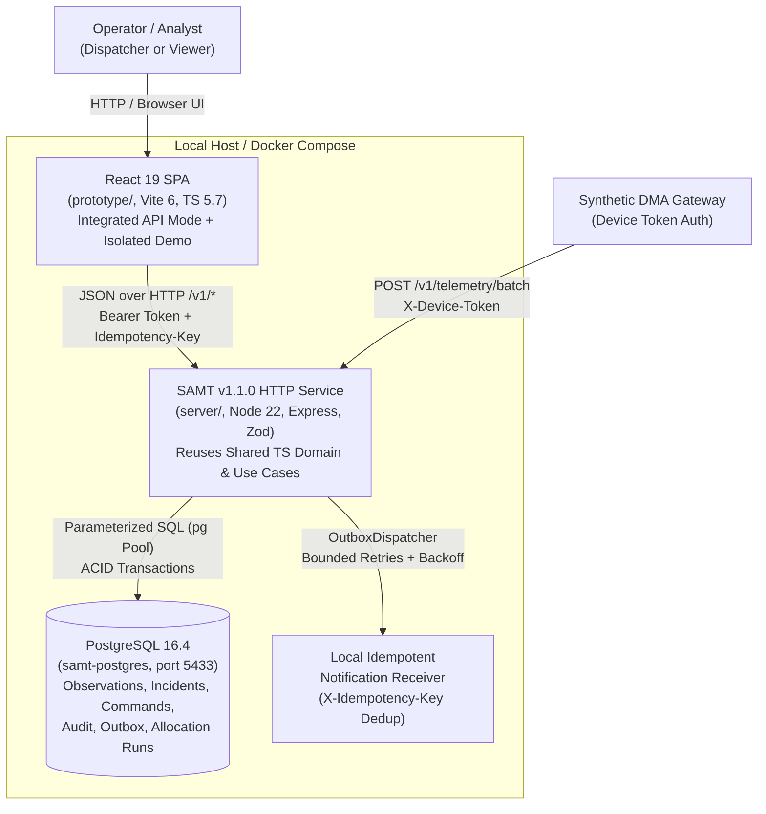
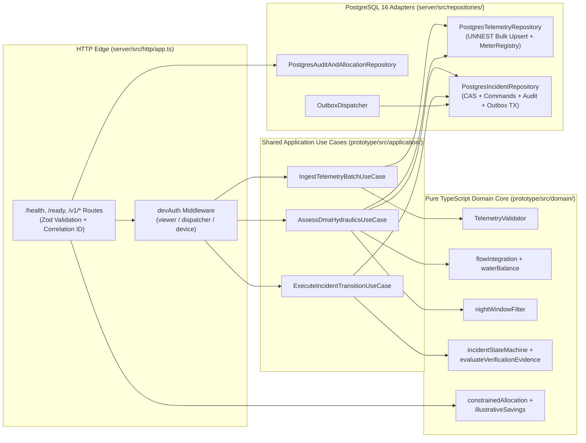

# SAMT — Su Əməliyyatlarının Mərkəzləşdirilmiş Təhlili
## Technical & Architectural Specification — Version 1.1.0

**Product / Specification Version:** `1.1.0`  
**API Route Prefix:** `/v1` (backward-compatible HTTP route prefix retained; breaking semantic fixes documented below)  
**Baseline Revision:** `main` at `4667e5dc21d5216505e9dbfeb9b4a11634fad158` (`v1.0.1`)  
**Working Branch:** `feat/samt-v1.1.0`  
**Date:** November 23, 2026 (Asia/Baku)  
**Author:** Elmaddin Mohubbatov (Group 550RI-I / Team SAMT, Course: Software System Design)  
**Operational Scope:** Local persistent decision-support prototype using synthetic DMA data. Physical valve actuation, live utility integration, government cloud deployment, and field-measured water savings are explicitly outside `v1.1.0` scope.

---

## 1. Baseline-to-v1.1.0 Delta & Compatibility Decisions

### 1.1 Versioning & Compatibility Policy
- **Specification & Package Increment (`1.0.1` → `1.1.0`):** Updated across [`package.json`](./package.json), [`prototype/package.json`](./prototype/package.json), [`server/package.json`](./server/package.json), and [`contracts/openapi.yaml`](./contracts/openapi.yaml).
- **API Route Compatibility (`/v1`):** All REST endpoints remain under `/v1` because v1.0.1 had no running production consumers and v1.1.0 materializes the first live HTTP server. Where draft v1.0.1 contracts had unsafe or invalid semantics (e.g., caller-trusted `isSuccessful`, unversioned transitions without `expected_version`, OpenAPI 3.0.3 invalid `type: mutualTLS`, and `202 Accepted` without a real async queue), those fields were tightened before launching `/v1` live.
- **Historical Preservation:** [`report_1.md`](./report_1.md), [`report_2.md`](./report_2.md), [`SAMT_v1.0.0.md`](./SAMT_v1.0.0.md), and [`SAMT_v1.0.1.md`](./SAMT_v1.0.1.md) are preserved untouched as historical records.

### 1.2 Roadmap Reconciliation (`ADR-001`)
See [`docs/adr/ADR-001-v1.1.0-postgresql-monolith.md`](./docs/adr/ADR-001-v1.1.0-postgresql-monolith.md). In brief:
- **Implemented in `v1.1.0`:** One Node.js 22 / TypeScript modular monolith HTTP service (`server/`) reusing the pure TypeScript domain core (`prototype/src/domain/` and `prototype/src/application/`), backed by standard PostgreSQL 16 (`postgres:16.4-alpine`), versioned SQL migrations, transactional outbox + local idempotent recording receiver, and the connected React 19 UI.
- **Deferred to Future Target Architecture (§2.2):** TimescaleDB hypertable compression, PostGIS spatial queries, Kafka, Flink, Redis, Go/Rust mTLS 1.3 ingress, Python OR-Tools MILP, and Pact broker.

### 1.3 Key Defect Remediations from Baseline `4667e5d`
| Area | Baseline (`v1.0.1`) Defect | `v1.1.0` Resolution | Executable Reference |
| :--- | :--- | :--- | :--- |
| **Flow integration** | Integrated outside requested window; extrapolated unbounded leading/trailing gaps and counted them as measured coverage; fabricated volume from 1 sample. | Clipped strictly to `[windowStart, windowEnd]`; bounded gap exclusion (`dt > maxGapSec`); measured vs. bounded edge-hold separation; single point yields `0 m³` / `INSUFFICIENT_COVERAGE`; duplicate timestamps averaged deterministically. | [`flowIntegration.ts`](./prototype/src/domain/balance/flowIntegration.ts) |
| **Multi-meter balance** | `contracts/schema.sql` averaged inlet meters (`AVG(...) * 0.25`), undercounting multi-inlet DMAs; residuals labeled prematurely as NRW. | Buggy continuous aggregate retired; API loads per-meter observations and integrates each meter independently before summing (`2 × 100 m³/h × 0.25 h = 50 m³`); double-count guard on authorized consumption; signed residual explicitly qualified. | [`waterBalance.ts`](./prototype/src/domain/balance/waterBalance.ts), [`contracts/schema.sql`](./contracts/schema.sql) |
| **Repair verification** | Trusted caller-supplied `event.evaluation.isSuccessful`. | Authoritative domain/server evaluator (`evaluateVerificationEvidence`) compares comparable pre/post windows, sample/coverage bounds, provenance, and Torricelli pressure normalization; forged `isSuccessful: true` is ignored. | [`incidentStateMachine.ts`](./prototype/src/domain/incident/incidentStateMachine.ts) |
| **Concurrency & idempotency** | `InMemory` accepted same-version overwrites; JSON adapter skipped version checks & seed validation; shallow copies allowed nested mutation. | Strict `expectedVersion` CAS (`409` on stale/same-version), `command_id` + canonical SHA-256 payload-hash idempotency, deep-clone isolation, seed validation, and single-transaction ACID commit/rollback across all three adapters. | [`IncidentPort.ts`](./prototype/src/domain/ports/IncidentPort.ts), [`PostgresIncidentRepository.ts`](./server/src/repositories/PostgresIncidentRepository.ts) |
| **Telemetry identity & time** | Process-local `Set` dedup; conflated drift and historical age; missing device/meter/DMA binding, active check, and role/unit validation. | Durable PostgreSQL `UNIQUE (meter_id, observation_id)` dedup; active/device/DMA/role/unit checks; distinct `observed_at`, `transmitted_at`, and server-owned `received_at`; bounded `<= 72h` historical replay persists without triggering live dispatch. | [`validation.ts`](./prototype/src/domain/telemetry/validation.ts), [`IngestTelemetryBatchUseCase.ts`](./prototype/src/application/IngestTelemetryBatchUseCase.ts) |
| **React wiring** | `useMnfAnalysis` ignored injected clock; `DomainContext` fell back to `incidents[0]` across DMAs; corrupted toggle only zeroed header counter; Torricelli `Cd=0.62, A=20 cm², H=45 m` mislabeled as `38.4 m³/h`. | Connected Integrated Mode (`/v1` API, zero silent fallback) + isolated Static Demo Mode; strict DMA scoping with empty state; injected clock wired to `useMnfAnalysis`; fault toggle exercises real validator; Torricelli physics corrected (`≈ 132.64 m³/h`). | [`DomainContext.tsx`](./prototype/src/context/DomainContext.tsx), [`WorkOrderManager.tsx`](./prototype/src/components/organisms/WorkOrderManager.tsx) |

---

## 2. System Architecture

### 2.1 Actual Local Architecture (`v1.1.0` — Implemented & Verified)

#### C4 Container View (Local Runtime)


#### C4 Component View (`server/` + Shared Core)


#### Operational Sequence Diagram (Success, Conflict, Rollback, & DB Outage Paths)
```mermaid
sequenceDiagram
  autonumber
  participant Dev as Synthetic Gateway (Device)
  participant Op as Dispatcher UI
  participant API as SAMT /v1 HTTP API
  participant DB as PostgreSQL 16
  participant Recv as Local Receiver

  Dev->>API: POST /v1/telemetry/batch (X-Device-Token)
  API->>API: Validate binding, units, time drift vs <=72h historical age
  API->>DB: BEGIN -> UNNEST INSERT ON CONFLICT DO NOTHING + audit -> COMMIT
  alt Database unreachable
    DB-->>API: ECONNREFUSED / 57P01
    API-->>Dev: 503 DATABASE_UNAVAILABLE (write NOT acknowledged)
  else Committed
    DB-->>API: inserted + duplicate keys
    API-->>Dev: 200 ACCEPTED / PARTIALLY_ACCEPTED (received_at, correlation_id)
  end

  Op->>API: POST /v1/dma/DMA-YASAMAL-04/assess (Bearer dispatcher)
  API->>DB: Query LIVE [02:00, 04:00) AZT flow readings
  API->>DB: BEGIN -> INSERT leak_incidents(DETECTED,v1) + audit + outbox -> COMMIT
  API-->>Op: 201 Created (incident v1)

  Op->>API: POST /v1/incidents/{id}/transition (ASSIGN, expected_version=1, command_id=K1)
  API->>DB: BEGIN -> check incident_commands(K1) -> SELECT FOR UPDATE -> UPDATE WHERE version=1 -> INSERT audit + outbox + command -> COMMIT
  alt Concurrent stale writer (expected_version=1 after v2 committed)
    DB-->>API: version mismatch (actual=2) -> ROLLBACK
    API-->>Op: 409 VERSION_CONFLICT (current_version=2; UI prompts Refresh)
  else Injected pre-commit failure
    DB-->>API: ROLLBACK (incident, audit, command, outbox all untouched)
    API-->>Op: 500 error (safe for client to retry K1)
  else Duplicate retry of K1 with same payload
    DB-->>API: Prior command row matches payload_hash
    API-->>Op: 200 OK (idempotent_replay=true; zero extra audit/version bump)
  else First valid commit
    DB-->>API: COMMIT v2
    API-->>Op: 200 OK (ASSIGNED, v2)
  end

  API->>Recv: OutboxDispatcher POST /notify (X-Idempotency-Key)
  Recv-->>API: 200 RECEIVED (deduplicated; bounded retries up to 3, else DEAD_LETTERED)
```

### 2.2 Future Target Architecture (Planned / Not Active in `v1.1.0`)
The national-scale capabilities discussed in earlier milestones remain explicitly separated as target architecture pending real scale and utility integration requirements:
- **Edge mTLS 1.3 & gRPC/Protobuf Ingress:** Rust/Go ingress proxy terminating X.509 device certificates and ingesting binary streams conforming to [`contracts/telemetry.proto`](./contracts/telemetry.proto).
- **Distributed Streaming & Caching:** Apache Kafka partitioning by `dma_id`, Apache Flink continuous window jobs, and Redis hot-state caching.
- **Database Extensions:** PostGIS spatial polygon/pipeline queries (`ST_DWithin`) and TimescaleDB hypertable compression/retention as documented in [`contracts/schema.sql`](./contracts/schema.sql).
- **Optimization & External Integration:** Python OR-Tools MILP container for regional canal scheduling, Pact broker for multi-service contract testing, and sovereign cloud deployment.

---

## 3. Executable Contracts & Canonical Semantics

Rather than duplicating stale YAML/SQL/Protobuf listings inline, this specification links directly to the verified executable contracts:
- **HTTP OpenAPI 3.1.0 Specification:** [`contracts/openapi.yaml`](./contracts/openapi.yaml) — validated by `@apidevtools/swagger-parser` and live HTTP schema contract tests (`server/tests/openApiContract.test.ts`).
- **Executable PostgreSQL 16 Migration:** [`server/migrations/001_initial_schema.sql`](./server/migrations/001_initial_schema.sql) — executed by `npm run db:migrate`.
- **Optional Future Extensions DDL (Non-Active):** [`contracts/schema.sql`](./contracts/schema.sql) — preserves optional TimescaleDB/PostGIS target definitions and explicitly retires the buggy v1.0.1 cross-meter `AVG(...) * 0.25` aggregate.
- **Binary Telemetry Contract (Contract-Only in `v1.1.0`):** [`contracts/telemetry.proto`](./contracts/telemetry.proto) — compiled via real `protoc` (`libprotoc 3.19.1`), with measured fixture `yasamal_dma04_60_records_15s_window` (`60` records): **5,319 bytes** raw Protobuf (`88.65 B/record`), **631 bytes** gzipped Protobuf, vs. **12,720 bytes** raw JSON ([`verification-evidence/02-contracts-check.json`](./verification-evidence/02-contracts-check.json)).

### 3.1 Canonical Physical Units & Calculation Conventions
- **Telemetry metrics:** `FLOW_M3H` → `m3/h`, `PRESSURE_BAR` → `bar`, `LEVEL_METERS` → `m`. Non-canonical units or role-incompatible metrics are rejected at ingestion.
- **Flow integration:** Clipped trapezoidal integration per meter over `[windowStart, windowEnd]`. Interior gaps `> maxGapSec` are excluded from measured coverage and volume. Under default `BOUNDED_HOLD`, edge gaps `<= expectedSampleIntervalSec` contribute strictly to `estimatedBoundaryVolumeM3` (kept distinct from `measuredVolumeM3` and never inflating `coverageRatio`). Under `STRICT_INTERIOR`, 60 samples at 15s (`0..885s`) integrate `14m45s` (`24.5833 m³`), while 61 endpoint samples (`0..900s`) integrate full `15m00s` (`25.0000 m³`).
- **Water balance:** `signedResidualM3 = (sum(inlets) - sum(outlets)) - authorizedConsumptionM3 - storageChangeM3`. Positive `storageChangeM3` means water refilled/accumulated inside DMA storage; negative means storage drained into the DMA. Metered `CONSUMER` contributions cannot be combined with a flat `authorizedBilledConsumptionM3` allowance (double-count guard). Positive residuals are qualified as unexplained boundary residuals, not confirmed NRW or physical leaks without MNF/field corroboration.
- **Constrained allocation:** Deterministic progressive-filling heuristic (explicitly **not** MILP optimality) declaring `volume_unit` (`THOUSAND_M3` or `M3`) and `delivery_horizon_hours` (`24` default). Undefined Gini cases (zero demand or zero allocation) return `gini_index: null`.
- **Illustrative savings:** Torricelli pressure normalization $Q_{\text{base,norm}} = Q_{\text{base}} (P_{\text{post}} / P_{\text{base}})^\alpha$ ($\alpha \in [0.5, 1.5]$), preserving negative results and rejecting non-positive pressure or negative flow. Qualified explicitly as modeled illustrative estimates, not field-measured savings or IPMVP compliance.

### 3.2 Identity, Time, Authorization, & Audit Semantics
- **Three distinct timestamps:** `observed_at` (sensor time), `transmitted_at` (gateway send time), and server-owned `received_at` (`Clock.now()`).
- **Clock drift vs. observation age:** `|transmitted_at - received_at| > 15 min` or `observed_at > received_at + 15 min` → `QUARANTINED`. Authenticated observations with `15 min < received_at - observed_at <= 72 h` → `HISTORICAL_REPLAY` (persisted, excluded from live operational incident dispatch). Age `> 72 h` → `REJECTED`. Caller flags cannot bypass authentication, device/meter/DMA binding, or time bounds.
- **Server-side RBAC:** Resolved solely from environment-configured credentials (`SAMT_VIEWER_TOKEN`, `SAMT_DISPATCHER_TOKEN`, `SAMT_DEVICE_TOKENS_JSON`) using constant-time comparison; secrets are redacted from logs:
  - `viewer`: read-only GET (`403` on all incident mutations, assessments, and telemetry ingestion).
  - `dispatcher`: full read + `/v1/dma/:id/assess`, `/v1/incidents/:id/transition`, `/v1/outbox*`, persisted allocation runs (`403` on device telemetry ingress).
  - `device`: restricted solely to `POST /v1/telemetry/batch` for meters bound to its authenticated `device_id` (`403` on all other routes and spoofed `gateway_id`).
- **Authoritative verification & audit:** Server derives `actor_id`, `actor_role`, and verification outcome (`VERIFIED_SYNTHETIC_POLICY`, `FAILED_REWORK_REQUIRED`, or `INSUFFICIENT_EVIDENCE`). Insufficient coverage/samples or incomparable windows return HTTP `422` and keep the incident in `REPAIRED`. Failed hydraulic checks revert `REPAIRED → IN_REPAIR`.

### 3.3 Consistency & Reliability Guarantees
- **Exact guarantee:** Single-database PostgreSQL ACID atomicity per request (`BEGIN ... COMMIT`). Every incident transition commits row update (`WHERE version = expected_version`), `incident_commands` idempotency row, `audit_events` row, and optional `notification_outbox` row atomically or rolls back all four together.
- **Idempotency scope:** At-most-once state transition per `command_id` within this service across server restarts. Same `command_id` with a different canonical SHA-256 payload hash fails with HTTP `409 IDEMPOTENCY_CONFLICT`. We do **not** claim globally exactly-once delivery across external networks.
- **Notifications:** Asynchronous dispatch uses the transactional `notification_outbox` table with bounded retries (`max_attempts = 3`, exponential backoff, `DEAD_LETTERED` on exhaustion) to a local receiver deduplicating on `X-Idempotency-Key`.

---

## 4. Empirical Verification, Workload Benchmark & Recovery Evidence

All figures below were measured locally on November 23, 2026 (`Intel Core i5-1155G7 @ 2.50GHz`, 8 logical cores, 15.8 GB RAM, Windows 11 + WSL2 Docker Engine 29.1.3, Node `v22.11.0`, PostgreSQL `16.4-alpine`). Raw logs are retained under [`verification-evidence/`](./verification-evidence/).

### 4.1 Test, Contract & E2E Summary
- **Domain & Adapter Unit Suite (`prototype/`):** 8 files, **47/47 tests passed**.
- **PostgreSQL Conformance, HTTP Workflow, Outbox, Dependency Failure & OpenAPI Contract Suite (`server/`):** 4 files, **13/13 tests passed** (total **60/60 automated Vitest tests**; [`verification-evidence/03-tests.txt`](./verification-evidence/03-tests.txt)).
- **Contracts Validation:** OpenAPI `3.1.0` dereferenced & checked; `telemetry.proto` compiled with `libprotoc 3.19.1` ([`verification-evidence/02-contracts-check.json`](./verification-evidence/02-contracts-check.json)).
- **Live Browser E2E (Headless Google Chrome via `playwright-core`):** Verified DMA isolation empty state (`DMA-NASIMI-02`), Viewer `403` rejection, Modal `Escape` dismiss, insufficient-evidence `422` block, full lifecycle to `CLOSED` (`v6`), full `page.reload()` persistence, `0` uncaught errors, and `0 px` horizontal overflow at `390×844` ([`verification-evidence/06-browser-e2e.json`](./verification-evidence/06-browser-e2e.json)).
- **CI Distinction:** [`.github/workflows/ci.yml`](./.github/workflows/ci.yml) defines the reproducible CI pipeline with a `postgres:16.4-alpine` service container; all runs documented here were executed locally, not on hosted GitHub Actions runners.

### 4.2 Reproducible Workload Benchmark & `EXPLAIN (ANALYZE, BUFFERS)`
Parameters: `seed = 20261123`, `batchSize = 60`, `warmupBatches = 5`, `measuredBatches = 60` (`3,600` measured observations, `3,900` total persisted), `concurrency = 4`, `errorCount = 0`, 100% row-count correctness check passed ([`verification-evidence/04-benchmark-and-explain.json`](./verification-evidence/04-benchmark-and-explain.json)):

| Variant | Duration | Throughput (req/s) | Throughput (obs/s) | p50 Latency | p95 Latency | p99 Latency | Errors |
| :--- | ---: | ---: | ---: | ---: | ---: | ---: | ---: |
| **Before:** Per-row `INSERT` loop inside TX | 22,350.09 ms | 2.68 req/s | 161.07 obs/s | 1,239.11 ms | 3,345.95 ms | 3,934.07 ms | 0 |
| **After:** Single bulk `UNNEST` upsert inside TX | **2,735.12 ms** | **21.94 req/s** | **1,316.21 obs/s** | **107.30 ms** | **479.51 ms** | **884.15 ms** | **0** |
| **Measured Delta** | **−87.8%** | **8.17×** | **8.17×** | **−91.3%** | **−85.7%** | **−77.5%** | — |

- **Query Plan Evidence:** On a selective 10-second slice (`650 / 3,900` rows), PostgreSQL 16 executed `Bitmap Index Scan on idx_telemetry_dma_metric_observed` in **`1.765 ms`** (`shared hit=2` index buffers; [`verification-evidence/07-explain-selective.txt`](./verification-evidence/07-explain-selective.txt)). When querying 100% of table rows (`3,900 / 3,900`), PostgreSQL appropriately selected `Seq Scan` (`11.402 ms`).
- **Limits:** These single-node local numbers do **not** validate the target national 40,000 observations/s architecture.

### 4.3 Isolated Backup & Restore Drill
Executed via `npm run drill:backup-restore` using `pg_dump -Fc` and restoring into an isolated database `samt_restore_drill` (never overwriting `samt_v1_1`; [`verification-evidence/05-backup-restore-drill.json`](./verification-evidence/05-backup-restore-drill.json)):
- **Backup (`pg_dump`):** `2,567.49 ms` (`85,999 bytes` custom archive).
- **Restore (`pg_restore` into `samt_restore_drill`):** **`6,478.83 ms`** elapsed recovery time.
- **Observed Data-Loss Window:** **`4,209 ms`** between backup start and a simulated post-backup write (verified absent in restored snapshot while all `3,900` pre-backup telemetry rows, `1` incident `v2`, and `66` audit rows matched 100%).
- **Observed vs. Target Distinction:** The `6.48 s` restore time and `4.21 s` observed window are measurements of a small local logical dump drill—not production SLA guarantees (future production targets: WAL-archived PITR `RPO <= 5 min`, `RTO <= 30 min`).
