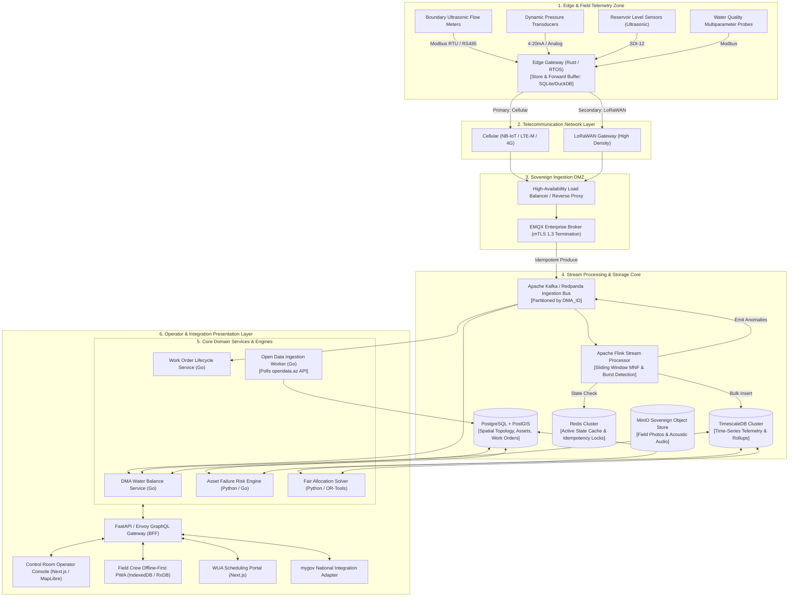
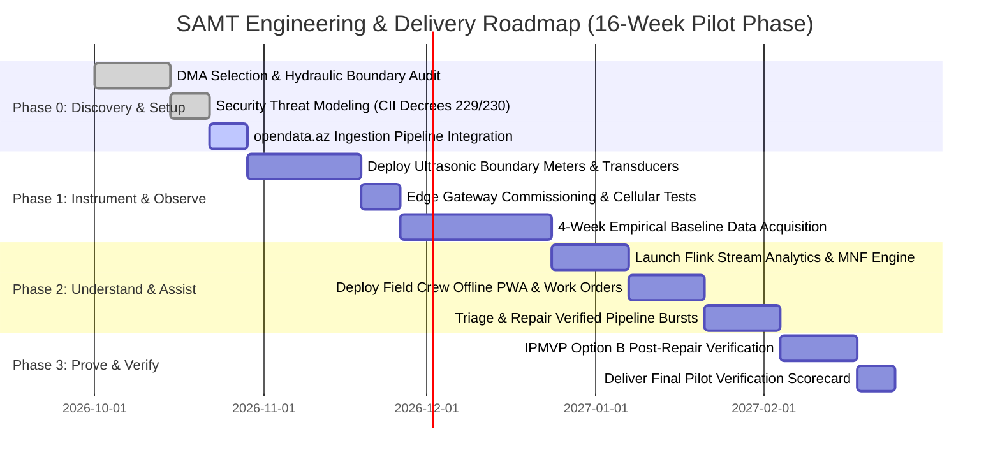

# SAMT — SYSTEM DESIGN & TECHNICAL SPECIFICATION
## Azerbaijan's National Water Intelligence & Allocation Platform

**Document Reference:** `SAMT-SYS-SPEC-2026-V1`  
**Classification:** Sovereign Critical Information Infrastructure (CII) Technical Specification  
**Governing Entities:** Azerbaijan State Water Resources Agency (ADSEA) / United Water Supply Service of Large Cities / Innovation and Digital Development Agency (IRIA)  
**Author:** Team SAMT (Systems Engineering & Architecture Core Team)  
**Date:** October 2026  
**Status:** Approved for Implementation (Pilot Phase)

---

## Table of Contents
1. [Executive Summary & System Vision](#1-executive-summary--system-vision)
2. [Problem Statement & Localized Context](#2-problem-statement--localized-context)
3. [Specific Subdomain (Domain-Driven Design Decomposition)](#3-specific-subdomain-domain-driven-design-decomposition)
4. [Open Data Integration (opendata.az)](#4-open-data-integration-opendataaz)
5. [End-to-End Solution Architecture](#5-end-to-end-solution-architecture)
6. [Technology Stack Selection & Technical Rationale](#6-technology-stack-selection--technical-rationale)
7. [Capacity Estimations & Scalability Math](#7-capacity-estimations--scalability-math)
8. [Requirements Engineering (Functional & Non-Functional)](#8-requirements-engineering-functional--non-functional)
9. [Infrastructure, Deployment Topology & Sovereign Security](#9-infrastructure-deployment-topology--sovereign-security)
10. [Pilot Implementation Scope, Delivery Roadmap & Verification (M&V)](#10-pilot-implementation-scope-delivery-roadmap--verification-mv)

---

## 1. Executive Summary & System Vision

### 1.1 Core Mission
**SAMT** is an enterprise-grade, distributed operational intelligence platform engineered specifically for Azerbaijan's municipal and agricultural water distribution networks. Built around a closed operational feedback loop—**Sense → Understand → Act → Prove**—SAMT connects low-power field edge telemetry directly to algorithmic anomaly localization, predictive pipe-failure risk modeling, dispatchable crew work orders, and mathematically auditable water allocation schedules.

```
       ┌───────────┐
       │   SENSE   │ Boundary flow, pressure transducers, tank levels, opendata.az
       └─────┬─────┘
             │
             ▼
       ┌───────────┐
       │ UNDERSTAND│ DMA water balance, Minimum Night Flow (MNF), pipe risk scoring
       └─────┬─────┘
             │
             ▼
       ┌───────────┐
       │    ACT    │ Ranked field repair queue, tanker routing, fair canal schedules
       └─────┬─────┘
             │
             ▼
       ┌───────────┐
       │   PROVE   │ Pre/post-repair M&V audit, verified saved m³, billing equity
       └─────┬─────┘
             │
             └────────── Loop back to continuous baseline calibration
```

### 1.2 Operational Stance: The Layer Behind the Form
Unlike administrative e-government portals (such as `mygov`) that focus on citizen-facing paperwork, bill settlement, and manual complaint submission, **SAMT is the operational nervous system running behind the interface**. It ingests continuous high-frequency telemetry from District Metered Areas (DMAs), automates physical loss localization, computes hydraulic mass balances, and provides field operators and Water User Associations (WUAs) with verifiable, evidence-backed decision support.

---

## 2. Problem Statement & Localized Context

### 2.1 The Core Contradiction
Azerbaijan presents a sharp structural paradox in water resource management:
* **High Nominal Access:** National statistics cite approximately **95% access to improved drinking water sources**.
* **Extreme Distribution Network Loss:** Non-Revenue Water (NRW) national physical losses are reported at **~28%** (cited as among the highest in the CIS region), while localized infrastructure in parts of **Greater Baku suffers from transmission and distribution losses reaching up to 55%**.
* **Supply vs. Transmission Reality:** The critical bottleneck is rarely the macro-availability of bulk water at primary reservoirs (e.g., Jeyranbatan Ultrafiltration complex, Shamkir, or Takhtakorpu reservoirs); rather, it is the invisible, unmetered, and unlocalized dissipation of treated water through aged cast-iron and asbestos-cement distribution pipes, coupled with uncalibrated agricultural canal diversions.

### 2.2 Climate, Agricultural & Economic Headwinds
1. **Accelerating Drought Footprint:** The territory of drought-affected agricultural cropland expanded rapidly from **68,600 hectares in 2020** to **178,300 hectares in 2023**, severely straining the Kura-Aras lowland farming basins.
2. **Economic Sensitivity:** Approximately **53% of Azerbaijan's national GDP** resides in sectors directly dependent on reliable water supply (agriculture, food processing, industrial manufacturing, petrochemicals, energy generation, and construction).
3. **Transboundary Vulnerability:** Upwards of 70% of the nation's surface freshwater resources originate outside sovereign borders (Georgia, Armenia, Turkey, Iran, Russia), making domestic distribution efficiency an urgent matter of national security.
4. **Target Alignment:** The Presidential decree establishing the Azerbaijan State Water Resources Agency (ADSEA) mandates universal digital metering, automated monitoring, and data-driven allocation frameworks targeting full modernization by **2040**.

### 2.3 The Institutional & Technical Gap
* **Administrative Digitization Exists:** Citizens can submit meter readings, pay tariffs online, and report surface bursts via e-government channels.
* **Operational Telemetry is Missing:** Most municipal secondary and tertiary networks lack boundary district flow meters, dynamic pressure logging, and automated hydraulic zone isolation.
* **Informal Allocation Schedules:** Rural irrigation delivery and emergency municipal water trucking frequently depend on non-transparent, paper-based, or manual "wait-your-turn" queues, lacking mathematical justification, objective crop-need weighting, or tamper-proof audit trails.

---

## 3. Specific Subdomain (Domain-Driven Design Decomposition)

Applying Domain-Driven Design (DDD) principles to the national water network reveals clear operational boundaries. SAMT isolates critical hydraulic calculations and allocation heuristics into autonomous Bounded Contexts.

```
+-----------------------------------------------------------------------------------+
|                                    SAMT SYSTEM                                    |
+-----------------------------------------------------------------------------------+
| [ CORE DOMAIN: DMA Leak Localization & MNF Analytics ]                            |
|   - Hydraulic Zone Mass Balance                                                   |
|   - Minimum Night Flow (MNF) Decomposition                                        |
|   - Pressure Transient & Burst Event Detection                                    |
+-----------------------------------------------------------------------------------+
| [ CORE DOMAIN: Equitable Multi-Criteria Allocation Engine ]                        |
|   - Mixed-Integer Linear Programming (MILP) Dispatch Scheduler                    |
|   - Crop Evapotranspiration (ETc) & Urgency Scoring                               |
|   - Reason-Coded Decision Ledger & Override Gatekeeper                            |
+-----------------------------------------------------------------------------------+
| [ SUPPORTING: Asset Risk Index ]   | [ SUPPORTING: Field Work Orders & M&V ]      |
|   - Likelihood x Consequence (LoF) |   - PWA Dispatch, Offline Sync & Photo Evidence|
|   - Pipe Stress & Corrosion Models |   - IPMVP Option B Water Savings Verification|
+------------------------------------+----------------------------------------------+
| [ SUPPORTING: Open Data & Macro Baseline Harmonizer (opendata.az) ]               |
|   - Bulk Inflow Calibration & River Control Boundary Context                      |
+------------------------------------+----------------------------------------------+
| [ GENERIC: IoT Device PKI & Reg ]  | [ GENERIC: Sovereign Security & CII Audit ]   |
|   - mTLS 1.3, Firmware Over-the-Air|   - RBAC, Decree 229/230 Compliance Ledger   |
+------------------------------------+----------------------------------------------+
```

### 3.1 Core Domains (High Business Value & Competitive Advantage)

#### Subdomain A: District Metered Area (DMA) Water Balance & Minimum Night Flow (MNF) Localization
* **Ubiquitous Language:** *Inflow Meter, Boundary Isolation Valve, Minimum Night Flow (MNF), Net Night Flow (NNF), Unavoidable Annual Real Losses (UARL), Burst Threshold, Acoustic Profile.*
* **Boundary & Responsibilities:** 
  * Computes the continuous mass balance across closed hydraulic envelopes:
    $$\Delta V_{\text{loss}}(t) = V_{\text{inflow}}(t) - \sum V_{\text{outflow}}(t) - \sum V_{\text{metered}}(t)$$
  * Analyzes flow rates between 02:00 and 04:00 AM local time to isolate legitimate domestic night use (active toilets, storage tanks) from background chronic leakage and sudden pipe bursts.
  * Ingests high-frequency pressure sensor readings (10–50 Hz burst transients) to detect pressure hammer events and localize rupture wavefronts.

#### Subdomain B: Equitable Multi-Criteria Water Allocation & Dispatch Engine
* **Ubiquitous Language:** *Allocation Window, Deficit Penalty, Crop Sensitivity Index ($K_c$), Days Since Delivery, Tanker Route Envelope, Reason Code, Emergency Override.*
* **Boundary & Responsibilities:**
  * Replaces discretionary municipal and irrigation distribution queues with a deterministic, constrained optimization engine.
  * Formulates equitable delivery schedules across competing agricultural users (WUAs) and drought-stressed municipalities, balancing physical delivery capacity, crop wilting points, and minimum human survival baselines ($50\text{ liters/person/day}$).
  * Emits an unalterable **Reason Code** and penalty score for every allocation or deferral, guaranteeing explainability to farmers and agency auditors.

### 3.2 Supporting Subdomains (Essential Domain Capabilities)

#### Subdomain C: Asset Health & Pipe-Failure Risk Indexing
* Computes the Risk Priority Number (RPN) for network segments:
  $$\text{RPN} = \text{Likelihood of Failure (LoF)} \times \text{Consequence of Failure (CoF)}$$
* **LoF Parameters:** Pipe installation era (Soviet-era vs. modern HDPE), material (asbestos cement, unlined ductile iron, steel), diameter, soil salinity/corrosivity in the Absheron peninsula, and historical burst frequency.
* **CoF Parameters:** Proximity to arterial roads (e.g., Heydar Aliyev Avenue), population density, critical infrastructure (hospitals, schools), and repair excavation difficulty.

#### Subdomain D: Field Work-Order Lifecycle & M&V Verification
* Manages the closed loop from alert triage to physical trenching.
* Dispatches mobile work orders to local utility repair crews via an offline-first Progressive Web App (PWA).
* Enforces empirical proof: captures GPS-tagged pre-repair acoustic/visual evidence, repair material used, and executes **IPMVP Option B (International Performance Measurement and Verification Protocol)** to verify drop in post-repair MNF against baseline.

#### Subdomain E: Open Data & Macro Telemetry Harmonization
* Regularly ingests and normalizes official open statistical indicators from `opendata.az`.
* Aligns local DMA boundary balances with macro-level river monitoring and national abstraction figures published by the State Statistical Committee and ADSEA.

### 3.3 Generic Subdomains (Off-the-Shelf or Standard Infrastructure)
* **IoT Device Registry & Mutual TLS Identity:** Manages device provisioning, cryptographic certificates, firmware status, battery voltage telemetry, and heartbeats.
* **Sovereign Security, RBAC & Audit Ledger:** Zero-Trust role-based authorization, multi-factor authentication, and append-only tamper-evident security logging in compliance with Azerbaijani CII legislation.
* **Notification & Citizen Gateway:** Low-latency event routing to the national SMS gateway, e-government notification channels, and dispatch webhooks.

---

## 4. Open Data Integration (opendata.az)

To ensure the platform is fundamentally grounded in national empirical data, SAMT establishes automated ingestion pipelines interfacing with the **Open Data Portal of the Republic of Azerbaijan (`opendata.az`)**.

```
┌────────────────────────────────────────────────────────────────────────┐
│                     AZERBAIJAN OPEN DATA PORTAL                        │
│                           (opendata.az)                                │
└───────────────────┬────────────────────────────────┬───────────────────┘
                    │                                │
                    ▼                                ▼
       ┌────────────────────────┐      ┌────────────────────────┐
       │   Dövlət Statistika    │      │  İri Şəhərlərin        │
       │       Komitəsi         │      │  Birləşmiş Su Təchizatı│
       └────────────┬───────────┘      └────────────┬───────────┘
                    │                                │
     ┌──────────────┴──────────────┐                 │
     ▼                             ▼                 ▼
┌──────────────┐            ┌──────────────┐  ┌──────────────┐
│Su resursları │            │Suvarılan     │  │Suyun         │
│və istifadə   │            │torpaqlar &   │  │keyfiyyəti -  │
│(Dataset 1)   │            │Su təchizatı  │  │Mərkəzi lab.  │
│              │            │(Dataset 4)   │  │(Dataset 2)   │
└──────┬───────┘            └──────┬───────┘  └──────┬───────┘
       │                           │                 │
       │     ┌─────────────────────┴──────────┐      │
       │     │   ADSEA Su Monitorinq Sektoru  │      │
       │     └─────────────────────┬──────────┘      │
       │                           ▼                 │
       │                    ┌──────────────┐         │
       │                    │Monitorinq    │         │
       │                    │nöqtələri     │         │
       │                    │(Dataset 3)   │         │
       │                    └──────┬───────┘         │
       │                           │                 │
───────┴───────────────────────────┴─────────────────┴───────────────────
                            SAMT PIPELINE
┌────────────────────────────────────────────────────────────────────────┐
│ Ingestion Worker: REST API / CSV Poller (Cron: 0 0 * * *)              │
│ Schema Normalization -> Geocoding -> PostgreSQL / TimescaleDB          │
└────────────────────────────────────────────────────────────────────────┘
```

The system ingests and cross-references four foundational datasets:

| Dataset Identifier | Publishing Agency | Data Frequency & Format | Core Parameters Utilized | SAMT Subsystem Mapping |
|---|---|---|---|---|
| **`Su resursları və onlardan istifadə edilməsi`** (Dataset 1) | State Statistical Committee of Azerbaijan (*Dövlət Statistika Komitəsi*) | Annual (Historical time series 2015–2024); CSV/JSON | - Total natural freshwater abstraction ($10^6\text{ m}^3$)<br>- Industrial & municipal consumption<br>- Transmission loss (*nəql edilərkən itən su*)<br>- Wastewater discharge | **Macro Water Balance Engine:** Calibrates top-down national water accounting against bottom-up aggregated DMA inflows. Validates baseline loss reduction metrics. |
| **`Suyun keyfiyyəti - Mərkəzi laboratoriya`** (Dataset 2) | United Water Supply Service of Large Cities (*İri Şəhərlərin Birləşmiş Su Təchizatı Xidməti* / ADSEA) | Daily sampling, aggregated weekly; CSV/XLS | - Residual chlorine concentration ($mg/L$)<br>- Turbidity (NTU)<br>- Total dissolved solids (TDS)<br>- Coliform and bacteriological counts across Greater Baku & Absheron | **Multi-Parameter Anomaly Engine:** Correlates pressure drops with sudden drops in residual chlorine or spikes in turbidity to detect pipe breaches causing contaminant ingress. |
| **`Monitorinq nöqtələri`** (Dataset 3) | ADSEA Water Monitoring Sector (*Su Monitorinq Sektoru*) | Static GIS points with periodic updates; GeoJSON/CSV | - River observation stations (Kura, Aras, Samur, etc.)<br>- Geographic coordinates (WGS84 Lat/Long)<br>- Background section (*fon kəsiyi - f/k*)<br>- Control section (*nəzarət kəsiyi - n/k*) | **Hydraulic Boundary Ingestion:** Establishes intake boundary conditions for main transmission aqueducts (Samur-Absheron Canal, Kura-Baku pipelines) feeding municipal water treatment plants. |
| **`Su təchizatı` & `Suvarılan torpaqlar`** (Dataset 4) | State Statistical Committee & Ministry of Agriculture | Annual regional series; CSV | - Irrigated agricultural land by district (hectares)<br>- Water supply network length (km)<br>- Population served per rayon | **Equitable Allocation Engine:** Feeds regional base demand quotas ($m^3/\text{ha}$) and establishes the baseline denominators for agricultural water deficit penalties. |

### 4.1 Ingestion & Normalization Architecture
1. **Collector Worker:** A lightweight containerized Go worker runs a scheduled daily cron poller against `opendata.az/api/v1/datasets/`.
2. **Schema Validator:** Enforces JSON schema typing, converting comma-decimal Azerbaijani formatting (e.g., `"12,45"`) into standardized IEEE floating-point numbers.
3. **Spatial Projection:** Transforms regional name strings into standard ISO 3166-2:AZ administrative identifiers, mapping them to PostGIS geometry boundaries.
4. **Data Lineage:** Every row imported from `opendata.az` retains source URLs, checksum hashes, and ingestion timestamps in the `raw_external_dataset_log` table for auditability.

---

## 5. End-to-End Solution Architecture

SAMT is designed as an event-driven, microservices-based distributed system built for extreme network resilience, asynchronous stream processing, and sub-second operational alerting.



### 5.1 Step-by-Step Data Flow
1. **Edge Sampling:** Physical sensors sample flow every 15 seconds and pressure at 1 Hz. The edge gateway performs edge validation (range-checking, battery check, zero-flow checks).
2. **Buffer & Transmit:** Telemetry payloads are encoded into compact Protocol Buffers and transmitted over MQTT via TLS 1.3. If cellular connectivity drops, the gateway buffers up to 72 hours of readings in an encrypted local flash database.
3. **Ingestion DMZ:** The EMQX cluster validates client certificates (mTLS), terminates the secure connection, and publishes messages to the `telemetry.raw` Kafka topic, partitioned by `DMA_ID`.
4. **Stream Processing (Flink):** Flink evaluates 15-minute sliding windows for water balance, compares night flows (02:00–04:00 AM) against dynamic baselines, and flags statistical spikes ($\Delta Q > 3\sigma$).
5. **Storage Persistence:** Raw telemetry streams directly into TimescaleDB hypertables with native LZ4 compression. High-level incidents are committed transactionally to PostgreSQL.
6. **Action & Verification:** Validated anomalies trigger the automated creation of work orders, assigning nearby crews via the PWA, while the Fair Allocation Solver continuously updates downstream canal delivery tables.

---

## 6. Technology Stack Selection & Technical Rationale

The technical stack is chosen for zero-data-loss durability, sub-second query performance on massive time-series arrays, sovereign deployment compatibility, and strict operational security.

| Layer | Selected Technologies | Architectural Justification & Trade-off Analysis |
|---|---|---|
| **Edge Hardware & Firmware** | Industrial ARM Cortex-M4 / ESP32-S3 Edge Gateways; Firmware written in **Rust / FreeRTOS** | **Zero Memory Leaks:** Rust ensures memory safety without garbage-collection pauses. Extremely low power profile allows 5–7 year battery life on lithium thionyl chloride ($LiSOCl_2$) cells in remote meter pits. |
| **Edge Storage** | **SQLite (WAL mode) / DuckDB embedded** | Provides robust, crash-resilient store-and-forward local storage during GSM tower outages or heavy storm partitions. |
| **IoT Ingestion Protocols** | **MQTT v5.0 over TLS 1.3**; CoAP / UDP fallback | MQTT 5.0 supports user properties, message expiry intervals, and flow control. Binary serialization via **Protocol Buffers (Protobuf)** minimizes cellular data overhead to $<120\text{ bytes}$ per packet. |
| **Ingestion Broker** | **EMQX Enterprise / VerneMQ** | Capable of handling $1,000,000+$ concurrent MQTT client connections with high throughput, native Kafka bridges, and hardware-accelerated TLS termination. |
| **Message Streaming** | **Apache Kafka / Redpanda** | Distributed, immutable commit log. Partitioning by `dma_id` guarantees strict in-order message delivery for individual hydraulic zones while scaling horizontally. |
| **Stream Analytics** | **Apache Flink** | True event-driven stream processing (not micro-batching like Spark Streaming). Native support for out-of-order data using event-time watermarks and stateful sliding windows for night-flow calculation. |
| **Time-Series Database** | **TimescaleDB (PostgreSQL Extension)** | Combines the raw analytical speed and columnar compression of time-series systems with standard SQL relational integrity and ACID guarantees. Eliminates the split-brain operational burden of maintaining separate relational and time-series DBs. |
| **GIS & Relational Database** | **PostgreSQL 16 + PostGIS 3.4** | The global gold standard for spatial network topology. Allows complex spatial routing, pipe intersection analysis, and DMA boundary polygon containment queries. |
| **In-Memory Cache & State** | **Redis Cluster 7.2** | Sub-millisecond retrieval of active sensor states, dynamic configuration thresholds, rate-limiting tokens, and distributed locking (`Redlock`). |
| **Object Storage** | **MinIO (S3-Compatible)** | Sovereign on-premise object storage for field crew repair photos, acoustic leak sound WAV files, and ground-penetrating radar scans. |
| **Core Domain Services** | **Go (Golang 1.22)** | High-throughput, low-latency microservices with minimal RAM footprints and simple concurrency primitives (`goroutines`). |
| **Optimization Engines** | **Python 3.11 + Google OR-Tools / SciPy** | Mixed-Integer Linear Programming (MILP) solvers for canal schedule dispatching and vehicle routing (water tankers). |
| **Operator Web Console** | **Next.js 14 / React / TypeScript** + **MapLibre GL / Deck.gl** | GPU-accelerated spatial rendering of millions of pipe segments and real-time pulsing telemetry nodes directly in the browser. Styled with a high-contrast dark operational design system. |
| **Field Crew PWA** | **Progressive Web App (PWA) + RxDB / IndexedDB** | Zero-install deployment on ruggedized Android tablets. Full offline capability: work orders, maps, and forms remain functional underground; syncs automatically upon resurfacing. |

---

## 7. Capacity Estimations & Scalability Math

To ensure system viability over the complete national modernization timeline, capacity estimations are modeled across three progressive operational phases:
* **Phase 1 (Pilot):** 1 Selected District Metered Area (DMA) in Greater Baku (~7,500 subscribers).
* **Phase 2 (Greater Baku Scale):** 150 DMAs covering Baku and the Absheron Peninsula (~1.5M population).
* **Phase 3 (National Modernization Scale):** 500 Urban DMAs + 20,000 Agricultural Canal/Gate Sensors + 250,000 Smart Bulk & Commercial Meters nationwide.

```
+---------------------------------------------------------------------------------------------+
|                                    PHASED CAPACITY SIZING                                   |
+--------------------------+-----------------------+--------------------+---------------------+
| Metric                   | Phase 1: Pilot (1 DMA)| Phase 2: Baku (150)| Phase 3: Nation (Full)
+--------------------------+-----------------------+--------------------+---------------------+
| Boundary Flow Nodes      | 4 units               | 600 units          | 2,000 units         |
| Dynamic Pressure Nodes   | 16 units              | 2,400 units        | 8,000 units         |
| Canal Gates / Levels     | 0 units               | 100 units          | 20,000 units        |
| Smart Bulk/Billing Meters| 1,500 units           | 50,000 units       | 250,000 units       |
| Total Active Endpoints   | 1,520 devices         | 53,100 devices     | 280,000 devices     |
| Sustained Ingestion Rate | ~5 events/sec         | ~580 events/sec    | ~5,800 events/sec   |
| Peak Burst Rate (Hammer) | ~50 events/sec        | ~3,500 events/sec  | ~35,000 events/sec  |
| Daily Raw Telemetry      | ~0.04 GB / day        | ~4.8 GB / day      | ~48.2 GB / day      |
| Compressed TSDB (1 Year) | ~1.4 GB / year        | ~175 GB / year     | ~1.75 TB / year     |
+--------------------------+-----------------------+--------------------+---------------------+
```

### 7.1 Detailed Ingestion Rate & Mathematical Calculations

#### 1. Sampling & Reporting Frequencies
* **Boundary Inflow/Outflow Meters:** Sampled every 15 seconds; transmitted in 1-minute batches (4 readings/packet).
* **Pressure Transducers:** Standard sampling at 1-minute intervals (transmitting 1 reading/minute). During detected hydraulic shock/transient events (pressure gradient $dP/dt > 1.5\text{ bar/sec}$), sensor switches into burst mode transmitting 50 Hz data for 60 seconds.
* **Bulk & Commercial AMR/AMI Meters:** Transmitted once per hour (hourly consumption index, tamper flag, reverse flow).
* **Canal Sluice Gates & Reservoir Levels:** Transmitted once every 5 minutes.

#### 2. Event Throughput Calculations (Phase 3 National Scale)
* **High-Frequency Boundary Telemetry:**
  $$\text{Boundary Nodes} = 2,000 \times \left(\frac{1\text{ packet}}{60\text{ sec}}\right) \approx 33.3\text{ packets/sec}$$
* **Pressure Telemetry (Normal Mode):**
  $$\text{Pressure Nodes} = 8,000 \times \left(\frac{1\text{ packet}}{60\text{ sec}}\right) \approx 133.3\text{ packets/sec}$$
* **Irrigation Canal Level/Gate Telemetry:**
  $$\text{Canal Nodes} = 20,000 \times \left(\frac{1\text{ packet}}{300\text{ sec}}\right) \approx 66.7\text{ packets/sec}$$
* **Smart Bulk/Commercial Water Meters:**
  $$\text{Smart Meters} = 250,000 \times \left(\frac{1\text{ packet}}{3600\text{ sec}}\right) \approx 69.4\text{ packets/sec}$$
* **Steady-State Ingestion Rate:**
  $$\text{Throughput}_{\text{normal}} = 33.3 + 133.3 + 66.7 + 69.4 \approx 302.7\text{ packets/sec}$$
  *(With sub-readings unpackaged by Flink into discrete time-series rows, event processing rate $\approx 5,800\text{ events/sec}$).*
* **Peak Burst Rate (10% of network experiencing concurrent pressure transient/bursts):**
  $$\text{Throughput}_{\text{peak}} = 302.7 + \left(800 \text{ nodes} \times 50\text{ Hz}\right) \approx 40,300\text{ events/sec}$$

#### 3. Storage Footprint & Compression Analysis
* **Binary Protobuf Wire Payload:** Average 96 bytes per message (Timestamp: 8B, DeviceID: 16B, MetricValues: 32B, StatusFlags: 8B, Transport headers: 32B).
* **Network Bandwidth (Phase 3 Sustained):**
  $$\text{Bandwidth} = 302.7\text{ packets/sec} \times 96\text{ bytes} \approx 29.1\text{ KB/sec} \approx 0.23\text{ Mbps (negligible telecom load)}$$
* **Daily Ingestion Volume (Phase 3):**
  $$\text{Events/day} = 5,800\text{ events/sec} \times 86,400\text{ sec} \approx 5.01 \times 10^8\text{ readings/day}$$
  $$\text{Uncompressed Storage} = 5.01 \times 10^8 \times 96\text{ bytes} \approx 48.1\text{ GB/day (Raw unindexed)}$$
* **TimescaleDB Chunk Compression:**
  Using TimescaleDB columnar chunk compression grouped by `device_id` and ordered by `timestamp`, telemetry achieves **92% to 94% compression ratio**:
  $$\text{Compressed Storage/day} \approx 48.1\text{ GB} \times (1 - 0.93) \approx 3.37\text{ GB/day}$$
  $$\text{Annual Compressed Time-Series Footprint} \approx 3.37\text{ GB/day} \times 365 \approx 1.23\text{ TB/year}$$
* **Field Evidence Media Storage (MinIO Object Store):**
  * Estimated 50 active repair work orders/day across Azerbaijan.
  * 4 high-resolution geotagged photos per work order @ 3 MB each = $600\text{ MB/day} \approx 219\text{ GB/year}$.
  * Retained for 5 years = $1.09\text{ TB}$.

#### 4. Hardware Sizing & Compute Envelope (Phase 3 Production)
* **Kafka Cluster:** 3 Broker nodes (4 vCPU, 16 GB RAM, 500 GB NVMe each, replication factor = 3).
* **Flink Cluster:** 1 JobManager (4 vCPU, 8 GB RAM) + 4 TaskManagers (8 vCPU, 32 GB RAM each).
* **TimescaleDB Cluster:** Primary + Standby Hot Replica (16 vCPU, 64 GB RAM, 4 TB NVMe SSD in RAID 10, provisioned for $>15,000\text{ IOPS}$).
* **PostgreSQL (Spatial/App):** Primary + Standby (8 vCPU, 32 GB RAM, 1 TB SSD).
* **API & Application Tier:** 4 stateless container instances (4 vCPU, 8 GB RAM) behind an Envoy Load Balancer.

---

## 8. Requirements Engineering (Functional & Non-Functional)

```
┌──────────────────────────────────────────────────────────────────────────────────────────┐
│                                SYSTEM REQUIREMENTS MATRIX                                │
├──────────────────────────────────────────────────────────────────────────────────────────┤
│ FUNCTIONAL                                                                               │
│  [FR-01] Cryptographic Device Ingestion                                                  │
│  [FR-02] Real-Time Automated DMA Mass Balance                                            │
│  [FR-03] Minimum Night Flow (MNF) Decomposition                                          │
│  [FR-04] Pipe Failure Risk Indexing (LoF x CoF)                                          │
│  [FR-05] Work-Order State Machine & Evidence Logging                                     │
│  [FR-06] Equitable Multi-Criteria Allocation Optimizer                                   │
│  [FR-07] Reason-Coded Audit Engine & Override Logging                                    │
│  [FR-08] opendata.az Data Ingestion & Calibration Pipeline                               │
│  [FR-09] Post-Intervention M&V Water Savings Protocol                                   │
│  [FR-10] Multilingual Sovereign UI (Azerbaijani Primary)                                 │
├──────────────────────────────────────────────────────────────────────────────────────────┤
│ NON-FUNCTIONAL                                                                           │
│  [NFR-01] Ingestion-to-Screen Latency (P95 < 2s)                                         │
│  [NFR-02] High Availability & Uptime (99.9% Core)                                        │
│  [NFR-03] Edge Store-and-Forward Autonomy (72 Hours)                                     │
│  [NFR-04] Strict Zero-Data-Loss Ingestion (At-least-once with idempotency)                │
│  [NFR-05] Sovereign Critical Information Infrastructure (CII) Compliance (Decree 229/230)│
│  [NFR-06] Role-Based Access Control (RBAC) & Mutual TLS (mTLS 1.3)                       │
│  [NFR-07] Scalability (Linear horizontal scaling up to 1M endpoints)                     │
│  [NFR-08] Time-Series Tiered Retention & Pruning                                         │
│  [NFR-09] Offline-First Field Resiliency (IndexedDB PWA)                                 │
│  [NFR-10] Open API & Interoperability Standards (REST, Webhooks, OGC WMS/WFS)            │
└──────────────────────────────────────────────────────────────────────────────────────────┘
```

### 8.1 Functional Requirements (FR)
* **`FR-01: Cryptographic Device Ingestion`**  
  The system must authenticate all field gateways via X.509 client certificates using mTLS 1.3, rejecting any telemetry with invalid signatures, expired certs, or out-of-bounds timestamps ($>15\text{ minutes}$ clock drift).
* **`FR-02: Real-Time Automated DMA Mass Balance`**  
  The system must compute the net hydraulic balance for each configured DMA boundary polygon every 15 minutes, automatically accounting for multi-inlet and export boundary meters.
* **`FR-03: Minimum Night Flow (MNF) Decomposition`**  
  The system must isolate the 02:00–04:00 AM flow window daily, calculate the rolling 7-day 5th-percentile night flow, subtract legitimate customer night use baselines, and flag background physical leakage deviations.
* **`FR-04: Pipe Failure Risk Indexing`**  
  The system must calculate and visually map the RPN (Risk Priority Number) for every registered pipeline segment in the GIS database using material, soil type, pressure cyclicity, and historical repair frequency.
* **`FR-05: Work-Order State Machine & Evidence Logging`**  
  The system must enforce a strict state machine for leak repair work orders (`DETECTED` $\rightarrow$ `CONFIRMED` $\rightarrow$ `DISPATCHED` $\rightarrow$ `EXCAVATED` $\rightarrow$ `REPAIRED` $\rightarrow$ `VERIFIED`). Transition to `REPAIRED` requires at least one geotagged photograph and technician sign-off.
* **`FR-06: Equitable Multi-Criteria Allocation Optimizer`**  
  The system must compute fair water distribution schedules for irrigation canals and emergency municipal delivery tankers, factoring in crop wilting sensitivity ($K_c$), time elapsed since last delivery, soil moisture deficit, and delivery route costs.
* **`FR-07: Reason-Coded Audit Engine & Override Logging`**  
  Every schedule generated by the allocation engine must emit an explicit, machine-readable and human-readable Reason Code (e.g., `ALLOC_PRIORITY_CROP_CRITICAL`, `ALLOC_DEFERRED_EXCESS_QUOTA`). Any manual dispatcher override must mandate a written justification and capture a permanent cryptographic signature.
* **`FR-08: opendata.az Data Ingestion & Calibration Pipeline`**  
  The system must automatically ingest statistical data from `opendata.az` (water abstraction, losses, water quality, monitoring points) and compare macro transport losses against bottom-up empirical DMA losses.
* **`FR-09: Post-Intervention M&V Water Savings Protocol`**  
  Following an intervention, the system must execute an automated IPMVP Option B verification routine, comparing 14 days of post-repair night flow against pre-repair baselines (weather and pressure normalized) to compute verified cubic meters saved.
* **`FR-10: Multilingual Sovereign UI`**  
  The complete user interface (control room, field crew PWA, audit log) must provide native Azerbaijani language support as the default locale, with English available as an administrative secondary language.

### 8.2 Non-Functional Requirements (NFR)
* **`NFR-01: Ingestion-to-Screen Latency`**  
  P95 latency from the moment a physical sensor payload reaches the ingestion load balancer to its updated visualization on the control room operator screen must be $<2.0\text{ seconds}$.
* **`NFR-02: High Availability & Uptime`**  
  The core telemetry ingestion and stream processing pipelines must achieve $\ge 99.9\%$ annual uptime ($<8.76\text{ hours}$ unplanned downtime per year).
* **`NFR-03: Edge Store-and-Forward Autonomy`**  
  Edge gateways must retain full data integrity during telecommunication network partitions, buffering at least 72 hours of timestamped sensor readings in non-volatile flash storage and synchronizing gracefully without duplicate data loss upon reconnection.
* **`NFR-04: Strict Zero-Data-Loss Ingestion`**  
  The event pipeline must guarantee at-least-once message delivery from edge broker to Kafka, coupled with consumer idempotency based on unique `(device_id, timestamp)` composite keys to prevent duplicate record insertion.
* **`NFR-05: Sovereign Critical Information Infrastructure (CII) Compliance`**  
  The entire architecture must adhere strictly to Azerbaijani Cabinet of Ministers Decrees No. 229 & 230 (2023) governing Critical Information Infrastructure protection. Data must remain resident within the physical borders of the Republic of Azerbaijan on sovereign government cloud infrastructure (*Hökumət Buludu*).
* **`NFR-06: Role-Based Access Control (RBAC) & Auditability`**  
  Enforce least-privilege RBAC across all endpoints. Every administrative and operator interaction (view, acknowledge, dispatch, override) must be written to an immutable, append-only audit trail retained for 10 years.
* **`NFR-07: Scalability`**  
  The backend must scale linearly to accommodate a 50x increase in telemetry endpoints without requiring architectural restructuring or downtime.
* **`NFR-08: Time-Series Tiered Retention & Pruning`**  
  High-frequency 1-second raw telemetry must be retained for 90 days. Continuous rollups (15-minute, hourly) must be preserved indefinitely; downsampled daily rollups must be retained for at least 10 years.
* **`NFR-09: Offline-First Field Resiliency`**  
  The field crew Progressive Web App must remain fully interactive in deep underground pits and rural dead zones, caching route maps and forms locally via IndexedDB.
* **`NFR-10: Open API & Interoperability Standards`**  
  The system must expose standardized REST and GraphQL APIs, along with OGC-compliant (WMS/WFS) geospatial feeds for seamless interoperability with municipal GIS and civil protection emergency platforms.

---

## 9. Infrastructure, Deployment Topology & Sovereign Security

### 9.1 Multi-Zone Sovereign Network Topology

In accordance with State Service of Special Communication and Information Security (XRİTDX) guidelines for Critical Information Infrastructure, Kura implements a 4-tier air-gapped security zone architecture.

```
       ══════════════════════════════════════════════════════════════
       ZONE 0: OPERATIONAL TECHNOLOGY (OT) / FIELD NETWORK
       ──────────────────────────────────────────────────────────────
       [Boundary Meters] [Pressure Transducers] [Canal Sluice Actuators]
              │                  │                      │
              ▼                  ▼                      ▼
       [Encrypted Edge Gateways (Rust / Hardware Secure Element)]
       ══════════════════════════════════════════════════════════════
                                     │ (Cellular APN / Private VPN)
                                     ▼
       ══════════════════════════════════════════════════════════════
       ZONE 1: SECURE INGESTION DEMZ (Border Security Perimeter)
       ──────────────────────────────────────────────────────────────
       - Web Application Firewall (WAF) & DDoS Shield
       - Dual HAProxy / Envoy Reverse Proxies
       - EMQX Ingestion Cluster (mTLS 1.3 Termination, CRL Checking)
       ══════════════════════════════════════════════════════════════
                                     │ (Strict Unidirectional Kafka Bridge)
                                     ▼
       ══════════════════════════════════════════════════════════════
       ZONE 2: SOVEREIGN OPERATIONAL CORE (Hökumət Buludu / AzInTelecom)
       ──────────────────────────────────────────────────────────────
       - Kafka Streaming Message Bus (Internal-only)
       - Apache Flink Stream Workers
       - TimescaleDB Time-Series Engine (Encrypted at rest: AES-256)
       - PostgreSQL / PostGIS Spatial Database
       - Redis In-Memory State Cache
       - MinIO Sovereign Object Store
       - Go Microservices (Water Balance, Risk, Work Orders)
       - Python Allocation Engine (Constraint Solver)
       ══════════════════════════════════════════════════════════════
                                     │ (TLS 1.3 + OIDC / OAuth2)
                                     ▼
       ══════════════════════════════════════════════════════════════
       ZONE 3: SECURE MANAGEMENT & PRESENTATION TIER
       ──────────────────────────────────────────────────────────────
       - Control Room Operator Console (Next.js)
       - Field Crew PWA API Gateway
       - mygov E-Government National Gateway Adapter
       - opendata.az Scheduled Integration Scraper
       - XRİTDX Security Audit & SIEM Syslog Feeds
       ══════════════════════════════════════════════════════════════
```

### 9.2 Sovereign Cloud Hosting & CII Compliance
* **Data Residency:** Deployed on **Hökumət Buludu (Government Cloud)** managed by AzInTelecom LLC in Baku, with secondary disaster recovery replication located at the Yevlakh Data Center.
* **Air-Gap Separation of Control:** To mitigate cyber-physical risks to water infrastructure, the MVP strictly enforces **Read-Only Telemetry Ingestion**. Physical valve actuators and sluice gates are completely isolated from automated cloud control commands. Valve interventions require manual physical execution by certified utility crews.
* **Cabinet of Ministers Decrees No. 229 & 230:**
  * Mandatory automated vulnerability scanning and code provenance signing.
  * Integration with the National Computer Emergency Response Team (CERT.gov.az).
  * Storage of all cryptographic keys inside FIPS 140-2 Level 3 Hardware Security Modules (HSMs).

### 9.3 Disaster Recovery & High Availability
* **Recovery Point Objective (RPO):** $<1\text{ minute}$ for operational telemetry; $0\text{ seconds}$ (strict zero loss) for financial, audit, and work-order transactions.
* **Recovery Time Objective (RTO):** $<15\text{ minutes}$ for automated failover between primary (Baku) and secondary (Yevlakh) database clusters.

---

## 10. Pilot Implementation Scope, Delivery Roadmap & Verification (M&V)



### 10.1 Pilot Boundaries: What is IN vs. OUT of Scope

#### Strictly IN Scope (Pilot Phase):
* Selection of **1 bounded District Metered Area (DMA)** in Greater Baku (targeting an area with aged distribution mains and measurable boundary inlets, e.g., in Yasamal, Sabunchu, or Surakhani districts).
* Deployment of 4 electromagnetic/ultrasonic boundary meters and 16 dynamic pressure transducers.
* Integration of the daily data feed from `opendata.az` for water resources and local drinking water quality.
* Continuous 4-week baseline data collection (recording historical MNF and baseline pressure profiles).
* Operator alerting, automated work-order generation, and mobile crew dispatch via the offline PWA.
* Rigorous pre/post repair measurement and verification of physical water saved ($m^3$).

#### Strictly OUT of Scope (Pilot Phase):
* Autonomous cloud control of municipal valves or high-pressure pumps.
* Universal household-by-household smart water meter replacement (bulk DMA meters are utilized instead).
* Nationwide multi-district scale-up prior to formal pilot milestone sign-off.
* Public-facing unvalidated water loss ranking dashboards.

### 10.2 Empirical Verification Methodology (IPMVP Option B)

To guarantee that reported water savings represent genuine physical conservation rather than statistical noise or measurement drift, SAMT implements the **International Performance Measurement and Verification Protocol (IPMVP) Option B (Energy/Water Conservation Isolation)**.

```
Baseline Period (4-6 Weeks)                Intervention Window        Post-Repair Period (4 Weeks)
───────────────────────────────            ────────────────────       ────────────────────────────
Flow (m³/h)                                Crew repairs burst         Flow drops to new baseline
   ▲                                       & replaces pipe            ▲
80 │   ╭─╮   ╭─╮   ╭─╮                                             80 │
   │   │ │   │ │   │ │                                                │
50 │───╯─╰───╯─╰───╯─╰────────                                     50 │
   │   ▲                                                              │
20 │───┼──────────────────────                                     20 │───────╭─╮───╭─╮───╭─╮──
   └───┴──────────────────────► Time                                  │       │ │   │ │   │ │
       MNF Baseline = 50 m³/h                                         └───┴───╯─╰───╯─╰───╯─╰─►
                                                                          New MNF = 22 m³/h
                                                                          ΔQ_saved = 28 m³/h
```

#### Verification Formula:
$$\text{Volume Saved } (m^3) = \sum_{t=1}^{T} \left[ \left( Q_{\text{MNF, baseline}} - Q_{\text{MNF, post-repair}}(t) \right) \times \left( \frac{P_{\text{post}}(t)}{P_{\text{base}}} \right)^{\alpha} \times 24 \right]$$
* Where:
  * $Q_{\text{MNF, baseline}}$ is the average Minimum Night Flow ($m^3/\text{hour}$) established prior to repair.
  * $Q_{\text{MNF, post-repair}}(t)$ is the observed night flow following repair.
  * $P_{\text{post}} / P_{\text{base}}$ represents hydraulic pressure normalization to prevent artificial "savings" caused simply by low daytime pumping pressure.
  * $\alpha$ is the physical pipe leak exponent ($\alpha \approx 0.5$ for circular holes in rigid steel/iron; $\alpha \approx 1.15$ for longitudinal cracks in flexible plastics).

### 10.3 Pilot Scorecard & Kill/Scale Acceptance Gates

The transition from the pilot phase to a 150-DMA Greater Baku rollout is governed by strict, falsifiable criteria:

| Success Metric | Target Threshold | Mandatory Verification Method |
|---|---|---|
| **Telemetry Ingestion Reliability** | $\ge 98.5\%$ valid packets | Telemetry packets received with valid checksums and timestamps over 60 continuous days. |
| **Edge Autonomy Resilience** | $100\%$ zero data loss during simulated 48h blackout | Simulated telecommunication outage; full recovery and replay of buffered readings from gateway SQLite. |
| **Leak Detection Precision** | $\ge 80\%$ true positive rate | Percentage of algorithmic alerts confirmed as physical leaks upon crew field excavation. |
| **Mean Time to Confirm (MTTC)** | $\le 4\text{ hours}$ | Duration from automated anomaly emission in Kafka to operator validation on the control console. |
| **Verified Physical Water Loss Reduction** | $\ge 15\%$ reduction in DMA MNF | Statistically significant reduction in normalized Minimum Night Flow verified via IPMVP Option B. |
| **Economic Payback Feasibility** | Cost per $m^3$ saved $\le 0.40\text{ AZN}$ | Total annualized pilot amortized cost divided by verified cubic meters of treated water preserved. |

---

## 11. Conclusion

**SAMT** transforms Azerbaijan's water sector from a fragmented, historically unmonitored distribution network into an intelligent, transparent, and auditable cyber-physical utility ecosystem. By combining high-frequency edge telemetry with robust stream analytics, sovereign cloud infrastructure (*Hökumət Buludu*), open datasets from `opendata.az`, and mathematically objective allocation algorithms, SAMT ensures that **every loss is detected early, every repair is prioritized smartly, and every drop of water is allocated fairly.**

---
*End of Technical Specification — SAMT Platform Architecture 2026.*
