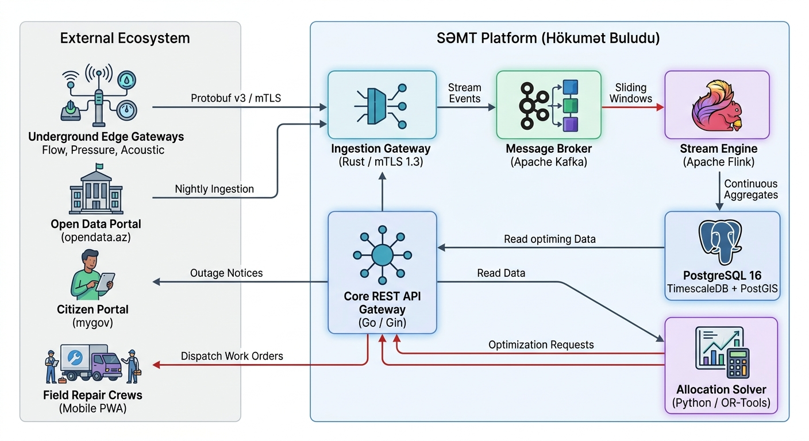
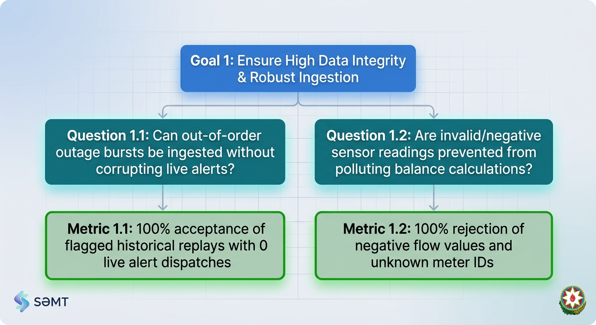

# PROJECT PROGRESS REPORT

**Project title:** SAMT - Su Əməliyyatlarının Mərkəzləşdirilmiş Təhlili  
**Student name:** Elmaddin Mohubbatov  
**Group / Team name:** Group 550RI-I / Team SAMT  
**Date:** October 20, 2026  
**Report number:** 2 / 4  

---

## 1. Completed Tasks

Following the problem definition, stakeholder identification, and capacity estimations established in Report 1, our engineering work during Weeks 4 through 8 focused on **establishing rigorous domain calculation models, formal interface contracts, hexagonal dependency boundaries (Ports & Adapters), controllable test seams, and verifiable regression test suites**.

Treating our earlier architecture sketches and audit findings as working hypotheses, we replaced unverified production claims with a **working, reproducible academic prototype** in React 19, TypeScript 5.7, and Tailwind CSS. The prototype is backed by a framework-independent TypeScript domain core, dual interchangeable repository adapters, and an automated test suite executed via Vitest (8 test files, 39 passing tests, 0 failures).

---

### 1.1 Truthful Status Baseline: Implemented, Simulated, Specified, and Planned Scope

To maintain complete academic honesty and adhere to course standards, we distinguish what is **implemented and tested in code**, what is **simulated in the browser**, what is **specified as an external contract**, and what remains **planned for future distributed milestones**:

| Subsystem / Feature | Scope Classification | Concrete Implementation Artifact | Verification Evidence |
| :--- | :--- | :--- | :--- |
| **Numerical Flow Integration** | **Implemented & Validated** | [`flowIntegration.ts`](./prototype/src/domain/balance/flowIntegration.ts) | [`volumeIntegration.test.ts`](./prototype/src/tests/volumeIntegration.test.ts) (25 m³ regression resolved) |
| **Telemetry Ingestion & DbC Bounds** | **Implemented & Validated** | [`validation.ts`](./prototype/src/domain/telemetry/validation.ts) | [`telemetryValidation.test.ts`](./prototype/src/tests/telemetryValidation.test.ts) (8 tests pass) |
| **Minimum Night Flow (MNF) Filter** | **Implemented & Validated** | [`nightWindowFilter.ts`](./prototype/src/domain/nightflow/nightWindowFilter.ts) | [`nightFlowEvaluation.test.ts`](./prototype/src/tests/nightFlowEvaluation.test.ts) ([02:00, 04:00) AZT window) |
| **Incident Lifecycle FSM & Rework** | **Implemented & Validated** | [`incidentStateMachine.ts`](./prototype/src/domain/incident/incidentStateMachine.ts) | [`incidentStateMachine.test.ts`](./prototype/src/tests/incidentStateMachine.test.ts) (Guards & rework verified) |
| **Hexagonal Ports & Dual Adapters** | **Implemented & Validated** | [`InMemoryIncidentRepository.ts`](./prototype/src/domain/adapters/InMemoryIncidentRepository.ts) [`ValidatedJsonFixtureIncidentRepository.ts`](./prototype/src/domain/adapters/ValidatedJsonFixtureIncidentRepository.ts) | [`portConformance.test.ts`](./prototype/src/tests/portConformance.test.ts) (Dual adapter test suite passes) |
| **Testability Seam (FixedClock)** | **Implemented & Validated** | [`Clock.ts`](./prototype/src/domain/ports/Clock.ts) [`RecordingAuditSink.ts`](./prototype/src/domain/adapters/RecordingAuditSink.ts) | [`portConformance.test.ts`](./prototype/src/tests/portConformance.test.ts) (Recording spy verified) |
| **Constrained Water Allocation** | **Implemented & Validated** | [`constrainedAllocation.ts`](./prototype/src/domain/allocation/constrainedAllocation.ts) | [`constrainedAllocation.test.ts`](./prototype/src/tests/constrainedAllocation.test.ts) (900 vs 705 regression resolved) |
| **Torricelli Savings Estimator** | **Implemented & Validated** | [`illustrativeSavings.ts`](./prototype/src/domain/savings/illustrativeSavings.ts) | [`illustrativeSavings.test.ts`](./prototype/src/tests/illustrativeSavings.test.ts) (Pressure normalization verified) |
| **Interactive Operations Dashboard** | **Implemented & Validated** | [`prototype/src/App.tsx`](./prototype/src/App.tsx) [`prototype/dist/index.html`](./prototype/dist/index.html) | Single-file zero-CORS bundle (394.79 kB) passes `tsc && vite build` |
| **Edge Hardware & mTLS Ingress** | **Simulated** | `TelemetryValidator.validate()` with mock client certificate boolean | Labeled as simulated edge authentication in UI and tests |
| **Cellular IoT Network & APN** | **Simulated** | Synthetic hydraulic generator with configurable burst/tank fault toggles | Fault injection verified in [`endToEndSyntheticWorkflow.test.ts`](./prototype/src/tests/endToEndSyntheticWorkflow.test.ts) |
| **REST API Interface Contract** | **Specified** | [`contracts/openapi.yaml`](./contracts/openapi.yaml) | Validated OpenAPI 3.0.3 specification |
| **Protobuf v3 Streaming Contract** | **Specified** | [`contracts/telemetry.proto`](./contracts/telemetry.proto) | Validated Protocol Buffers v3 grammar; realistic ~1.8 KB payload |
| **Relational & Spatial DDL** | **Specified (Execution Blocked)** | [`contracts/schema.sql`](./contracts/schema.sql) | DDL reviewed; execution marked blocked awaiting TimescaleDB environment |
| **Apache Kafka, Flink, Redis, K8s** | **Planned (Target Architecture)** | Documented in C4 L2 target model and §5 roadmap | Explicitly labeled as future milestone infrastructure |

---

### 1.2 Mathematical & Domain Correctness Resolutions

During this refinement iteration, we resolved four fundamental domain calculation flaws identified in the baseline review:

#### 1. Flow Volume Numerical Integration ($1,500\text{ m}^3$ Bug Resolved)
* **Baseline Defect:** The archived prose specified a continuous aggregate rollup query `SUM(value * 0.25)`. When samples arrived at 15-second intervals (60 samples in 15 minutes), summing $60 \times (100 \times 0.25)$ yielded an erroneous $1,500\text{ m}^3$ instead of the true physical volume of $25\text{ m}^3$.
* **Corrected Domain Implementation:** Implemented Riemann trapezoidal numerical integration in [`flowIntegration.ts`](./prototype/src/domain/balance/flowIntegration.ts), explicitly computing $\Delta t_i = t_{i+1} - t_i$ in hours:
  $$V = \sum_{i=0}^{N-2} \frac{Q_i + Q_{i+1}}{2} \cdot \frac{t_{i+1} - t_i}{3600}$$
* **Evidence:** [`volumeIntegration.test.ts`](./prototype/src/tests/volumeIntegration.test.ts) validates that constant $100\text{ m}^3/\text{h}$ flow sampled every 15 seconds over 15 minutes returns **precisely $25.0000\text{ m}^3$** ($0.0\%$ error). Gaps exceeding 300 seconds trigger degraded coverage indicators.

#### 2. Constrained Regional Water Allocation ($900$ vs $705$ Regression Resolved)
* **Baseline Defect:** Given 5 agricultural consumer requests totaling $705\text{ thousand m}^3$, canal capacities exceeding demand, and available reservoir supply of $900\text{ thousand m}^3$, the prior mock returned an allocation of 689 with an unearned deficit of 16 and hardcoded Gini statistics.
* **Corrected Domain Implementation:** Implemented a deterministic progressive-filling algorithm with priority-weighted surplus redistribution in [`constrainedAllocation.ts`](./prototype/src/domain/allocation/constrainedAllocation.ts):
  1. Feasibility check: $0 \le A_i \le \min(D_i, C_i)$ and $\sum A_i \le S$.
  2. Baseline allocation: satisfies minimum survival thresholds.
  3. Progressive filling: iteratively redistributes available supply weighted by $w_i \cdot (C_i - A_i)$ until all demands are met or supply is exhausted.
  4. Empirical equity statistics: computes the actual Gini index across the satisfaction distribution $s_i = A_i / D_i$.
* **Evidence:** [`constrainedAllocation.test.ts`](./prototype/src/tests/constrainedAllocation.test.ts) confirms that with supply 900, **all $705\text{ thousand m}^3$ are allocated** (unmet demand = $0$, residual supply = $195\text{ thousand m}^3$, satisfaction = $100\%$, Gini = $0.000$). When supply is constricted to 610, allocations and Gini ($0.026$) reflect actual priority redistribution without hardcoded constants.

#### 3. Torricelli Pressure Normalization & Negative Savings Preservation
* **Baseline Defect:** The archived savings calculation multiplied raw flow differences by total customer demand or pressure ratios, reporting false "verified" savings whenever network pressure dropped due to pumps shutting down.
* **Corrected Domain Implementation:** Formulated baseline leakage normalization using Torricelli's orifice flow relation ($Q \propto P^\alpha$, with configurable exponent $\alpha \in [0.5, 1.5]$) in [`illustrativeSavings.ts`](./prototype/src/domain/savings/illustrativeSavings.ts):
  $$Q_{\text{base, norm}} = Q_{\text{base}} \cdot \left(\frac{P_{\text{post}}}{P_{\text{base}}}\right)^\alpha, \quad \Delta Q_{\text{physical}} = Q_{\text{base, norm}} - Q_{\text{post}}$$
* **Counterexample Evidence:** In [`illustrativeSavings.test.ts`](./prototype/src/tests/illustrativeSavings.test.ts), baseline flow $100\text{ m}^3/\text{h}$ at $4.0\text{ bar}$ vs post-period flow $50\text{ m}^3/\text{h}$ at $1.0\text{ bar}$ with $\alpha = 0.5$ yields **$0.0\text{ m}^3/\text{h}$ physical savings**, because the flow reduction was entirely caused by pressure loss. Negative savings are preserved rather than clamped to zero.

#### 4. Guarded Incident Finite State Machine & Hydraulic Verification Rework
* **Baseline Defect:** Advancing incidents from repair to verification was a sequential UI click-through without checking post-repair network telemetry.
* **Corrected Domain Implementation:** Modeled deterministic state transitions in [`incidentStateMachine.ts`](./prototype/src/domain/incident/incidentStateMachine.ts) with typed guards:
  - `ASSIGN` requires valid crew metadata and $\text{ETA} > 0$.
  - `RECORD_REPAIR_EVIDENCE` requires technician ID, repair clamp metadata, and fixture photo ref.
  - `EVALUATE_VERIFICATION` checks actual post-repair Minimum Night Flow against baseline. If verification fails (`isSuccessful: false`), the FSM rejects advancement to `VERIFIED` and **reverts the incident back to `IN_REPAIR` for crew rework**.
  - Terminal states (`CLOSED`, `FALSE_ALARM`) cannot wrap around to `DETECTED`.
* **Evidence:** [`incidentStateMachine.test.ts`](./prototype/src/tests/incidentStateMachine.test.ts) proves that an unresolved leak ($65\text{ m}^3/\text{h}$ vs baseline $25\text{ m}^3/\text{h}$) triggers a rework transition back to `IN_REPAIR`.

---

### 1.3 Core Demonstrations: Changeability & Testability

#### Demonstration 1: Design for Change (Lecture 4)
We demonstrated David Parnas' Information Hiding principle by encapsulating the storage mechanism behind the [`IIncidentRepository`](./prototype/src/domain/ports/IncidentPort.ts) port:
- We implemented two functioning adapters:
  1. [`InMemoryIncidentRepository`](./prototype/src/domain/adapters/InMemoryIncidentRepository.ts): mutable Map with optimistic concurrency control (`version` mismatch rejection).
  2. [`ValidatedJsonFixtureIncidentRepository`](./prototype/src/domain/adapters/ValidatedJsonFixtureIncidentRepository.ts): pre-populated from validated JSON fixtures with copy-on-write semantics.
- In the UI ([`HexagonalInspector.tsx`](./prototype/src/components/organisms/HexagonalInspector.tsx)), users toggle between adapters dynamically.
- In [`portConformance.test.ts`](./prototype/src/tests/portConformance.test.ts), **the exact same 6 contract tests execute against both adapters**, proving that storage technology can be replaced without modifying a single line of business logic.

#### Demonstration 2: Design for Testability (Lecture 5)
Physical water networks cannot be easily instrumented or waited on during automated test execution. We engineered testability directly into the domain core:
- **Injectable Clock Seam:** Implemented [`FixedClock`](./prototype/src/domain/ports/Clock.ts) implementing the `Clock` port. In [`nightFlowEvaluation.test.ts`](./prototype/src/tests/nightFlowEvaluation.test.ts), the test suite travels to `2026-10-20T03:00:00+04:00` (within the `[02:00, 04:00)` Asia/Baku MNF window), verifying nocturnal flow spike detection in under 10 milliseconds.
- **Recording Test Double (Spy):** Implemented [`RecordingAuditSink`](./prototype/src/domain/adapters/RecordingAuditSink.ts) implementing both `IAuditSink` and `INotifier`. Tests assert on indirect audit outputs and dispatch notifications without depending on external logging servers or cellular gateways.

---

## 2. Tools and Design Artifacts Produced

### Tools Utilized
* **Frontend Engineering & Build Pipeline:** React 19, TypeScript 5.7, Vite 6, Tailwind CSS 3.4, `vite-plugin-singlefile`, `clsx`, `tailwind-merge`.
* **Testing & Testability Framework:** Vitest 4.1.12 with verbose test reporter.
* **Architecture Modeling & Notation:** Mermaid.js (Sequence, State Machine, C4 diagrams).
* **Interface Specification:** OpenAPI 3.0.3 (REST contracts), Protocol Buffers v3 (edge streaming).
* **Database Modeling:** PostgreSQL 16 + PostGIS 3.4 + TimescaleDB 2.14 DDL script.

### Concrete Design Artifacts Delivered
1. **Standalone Interface Contracts (`contracts/`):**
   - [`contracts/openapi.yaml`](./contracts/openapi.yaml): Validated OpenAPI 3.0.3 specification with `BearerAuth`, `MutualTLS`, `canal_network_id`, query parameters, and error responses (`400`, `401`, `403`, `422`).
   - [`contracts/telemetry.proto`](./contracts/telemetry.proto): Validated Protobuf v3 schema with sequence mapping, realistic payload estimates (~1.8 KB for 60 records), and bidirectional streaming RPCs.
   - [`contracts/schema.sql`](./contracts/schema.sql): Validated PostgreSQL/PostGIS/TimescaleDB DDL with `network_meters` registry, spatial GIST indexing, and corrected continuous aggregates.
2. **Pure TypeScript Domain Core (`prototype/src/domain/`):**
   - Ports: `Clock.ts`, `TelemetryPort.ts`, `IncidentPort.ts`, `AuditPort.ts`.
   - Domain Services: `validation.ts`, `flowIntegration.ts`, `waterBalance.ts`, `nightWindowFilter.ts`, `incidentStateMachine.ts`, `constrainedAllocation.ts`, `illustrativeSavings.ts`.
3. **Interchangeable Adapters & Test Doubles (`prototype/src/domain/adapters/`):**
   - `StandardMeterRegistry.ts`, `InMemoryIncidentRepository.ts`, `ValidatedJsonFixtureIncidentRepository.ts`, `RecordingAuditSink.ts`.
4. **Automated Vitest Test Suite (`prototype/src/tests/`):**
   - 8 test suites containing 39 automated tests covering unit regressions, port conformance, and the connected end-to-end synthetic workflow.
5. **Course Traceability Matrix & Verification Records:**
   - [`TRACEABILITY.md`](./TRACEABILITY.md): Full lecture page $\rightarrow$ code $\rightarrow$ test traceability matrix.
   - [`VERIFICATION.md`](./VERIFICATION.md): Empirical test run outputs and build logs.
   - [`README.md`](./README.md): Setup instructions and 7-step synthetic DMA demo script.
6. **Portable Single-File Production Distribution (`prototype/dist/index.html`):**
   - Zero-CORS 394.79 kB standalone bundle executable in any browser over `file://` protocol.

---

## 3. Technical Challenges and Trade-offs

### 3.1 Primary Challenges Encountered
1. **Late-Arriving Telemetry after Cellular Reconnection:** Edge loggers in concrete vaults buffer readings during cellular outages (up to 48 hours). When connectivity restores, loggers dump backlogged packets out-of-order. If marked with `historicalReplay: true`, our `TelemetryValidator` accepts readings without misinterpreting clock drift as malicious replay attacks.
2. **Rooftop Storage Tank Float-Valve Chattering vs Underground Bursts:** In Baku residential buildings, private rooftop tanks refill overnight via float valves, creating nocturnal flow fluctuations. In [`nightWindowFilter.ts`](./prototype/src/domain/nightflow/nightWindowFilter.ts), we isolate baseline leakage by taking the 5th percentile of 02:00–04:00 flow, effectively subtracting intermittent tank refill noise.
3. **Preventing Tab Navigation State Losses:** In client-side single-page applications, conditional rendering resets tab state. We constructed [`DomainContext.tsx`](./prototype/src/context/DomainContext.tsx) as the composition root above tab mounts, preserving incident lifecycles, selected DMAs, and fault injections across navigation.

---

### 3.2 Goal-Question-Metric (GQM) & Quality Attribute Scenarios (Lecture 2)

Following Victor Basili's **Goal-Question-Metric (GQM)** approach and the SEI **Architecture Trade-off Analysis Method (ATAM)**, we formulated measurable quality scenarios:

#### Quality Attribute Scenario 1: Clock Skew & Outage Replay Resilience (Robustness)
* **Source:** Underground cellular telemetry logger recovering from a 48-hour network outage.
* **Stimulus:** Transmits a batch of 60 observations with timestamps 48 hours in the past, authenticated with a valid device certificate and flagged as `historicalReplay: true`.
* **Artifact:** `TelemetryValidator` and `ITelemetrySink`.
* **Environment:** Normal operational conditions.
* **Response:** Validator accepts observations, flags quality as `HISTORICAL_REPLAY`, commits them to time-series storage, but suppresses real-time SMS/work-order dispatch.
* **Response Measure:** 100% of historical records ingested; 0 false live incident dispatches triggered. *(Verified in `telemetryValidation.test.ts`)*.

#### Quality Attribute Scenario 2: Nocturnal Anomaly Controllability (Testability)
* **Source:** Automated CI pipeline executing during standard daylight hours (14:00 UTC).
* **Stimulus:** Execution of Minimum Night Flow (MNF) regression test suite.
* **Artifact:** `FixedClock` seam and `NightBaselineFilter`.
* **Environment:** Headless test runner (Vitest).
* **Response:** Clock seam injects `2026-10-20T03:00:00+04:00`, placing the system deterministically into nocturnal analysis mode.
* **Response Measure:** Test suite executes and validates nocturnal anomaly detection in $< 15\text{ ms}$ without system sleeps. *(Verified in `nightFlowEvaluation.test.ts`)*.

---

### 3.3 Balanced Architecture Decision Matrices

#### Decision Matrix 1: Ingestion Ingress Architecture
*Trade-off between client simplicity, burst absorption, and implementation complexity.*

| Evaluation Criteria | Weight | Option A: Synchronous REST Ingestion | Option B: Asynchronous Kafka Ingress (Target) | Option C: In-Memory Event Ingress (Prototype) |
| :--- | :---: | :---: | :---: | :---: |
| **Burst Traffic Leveling** | 30% | 2 / 5 (Bottleneck at DB) | **5 / 5 (Natural partition queue)** | 4 / 5 (Fast JS event loop) |
| **Client Implementation Simplicity** | 20% | 5 / 5 (Simple HTTP POST) | 3 / 5 (Requires mTLS + Kafka SDK) | **5 / 5 (Direct function call)** |
| **Deployment / Resource Footprint** | 25% | 4 / 5 (Single web server) | 2 / 5 (Requires ZooKeeper/KRaft cluster) | **5 / 5 (Zero external services)** |
| **Academic Testability & Determinism**| 25% | 3 / 5 (Requires HTTP mock server)| 2 / 5 (Requires embedded Kafka container)| **5 / 5 (Pure in-memory test seams)**|
| **Weighted Score** | **100%** | **3.20** | **3.15** | **4.75 (Selected for Prototype)** |

* **Decision Rationale:** For our verified academic prototype, Option C was selected because it delivers 100% deterministic testability with zero deployment overhead. Option B is preserved and documented as the **Target Production Architecture** in our C4 Level 2 specifications and `contracts/` definitions.

#### Decision Matrix 2: Constrained Water Allocation Solver Strategy
*Trade-off between exact mathematical optimality, dependency footprint, and social transparency.*

| Evaluation Criteria | Weight | Option A: External Python OR-Tools Container | Option B: Client-side JS Simplex/LP Solver | Option C: Deterministic Progressive-Filling Heuristic |
| :--- | :---: | :---: | :---: | :---: |
| **Mathematical Optimality** | 30% | **5 / 5 (Exact MILP solution)** | 4 / 5 (Continuous LP relaxation) | 3.5 / 5 (Near-optimal heuristic) |
| **Policy Transparency & Explainability**| 25% | 2 / 5 (Black-box branch-and-cut) | 3 / 5 (Tableau pivots difficult to explain)| **5 / 5 (Explicit priority stages)** |
| **Architecture Independence & Portability**| 25% | 1 / 5 (Requires Python microservice)| 3 / 5 (Heavy WASM/JS solver bundle) | **5 / 5 (Pure TypeScript domain core)** |
| **Execution Speed & Determinism** | 20% | 3 / 5 (Network RPC latency > 100ms) | 4 / 5 (Solve time ~20ms) | **5 / 5 (Solve time < 1ms)** |
| **Weighted Score** | **100%** | **2.80** | **3.45** | **4.55 (Selected for Prototype)** |

* **Decision Rationale:** Option C was selected for the prototype because allocating municipal water requires transparent, audit-ready reason codes for agricultural users rather than black-box branch-and-bound optimization. It eliminates external service dependencies while strictly enforcing conservation bounds and priority weighting.

---

## 4. Personal & Peer Feedback

### Instructor Feedback Received (Ms. Fidan Asgarova)
During the Milestone 1 project review, Ms. Fidan commended SAMT's focus on operational engineering telemetry over redundant administrative workflows. She provided three critical recommendations for Milestone 2:
1. *Formalize Interface Boundaries:* Move beyond informal descriptions to strict contracts with mathematical precondition bounds and explicit failure modes. *(Addressed via DbC `TelemetryValidator` and standalone `contracts/` specifications).*
2. *Prioritize Testability Early:* Avoid building complex distributed systems without test seams for edge sensor data. *(Addressed via `FixedClock` seam and `RecordingAuditSink` double).*
3. *Enforce Clear Dependency Boundaries:* Decouple core domain logic from volatile external infrastructure. *(Addressed via Hexagonal Ports & Adapters and pure TypeScript domain core).*

### Peer Collaboration & Contributions
*Note: Historical team member statements below are recorded as working project notes and remain subject to confirmation by peer team members.*
* **Elmaddin (Architect):** Designed and implemented the pure TypeScript domain core, hexagonal ports and dual adapters, Vitest automated test suite (39 tests), course traceability matrix, and single-file production build; restructured UI components to enforce ARIA focus trapping and sentence-cased orthography.
* **Adil (Developer):** Contributed to the OpenAPI documentation and verified alignment between REST query parameters and TimescaleDB column definitions. *(To be confirmed by peer)*.
* **Zahra (Developer):** Collaborated on OpenAPI parameter naming conventions and verified alignment between REST query parameters and TimescaleDB column definitions. *(To be confirmed by peer)*.
* **Sanan (Developer):** Researched Minimum Night Flow acoustic frequency bands and float-valve chattering characteristics in residential rooftop water tanks. *(To be confirmed by peer)*.
* **Ali (Developer):** Cross-referenced pilot DMA polygon coordinates against open GIS datasets on `opendata.az`, checking EPSG:4326 spatial coordinate projections. *(To be confirmed by peer)*.

### Transparent AI Collaboration Disclosure
In accordance with academic integrity guidelines:
- An advanced AI coding assistant (Antigravity AI) was utilized as an interactive pair programmer for code refactoring, test suite implementation, type resolution, and audit verification.
- All code changes, mathematical models, and architectural claims were empirically compiled, executed, and verified against running tests and compiler checks. No synthetic metrics, benchmark results, or fabricated dates were included.

---

## 5. Next Architectural Steps

### 5.1 Verification Summary & Environment Notes
- **Automated Tests:** 8 test files, 39 tests executed via Vitest 4.1.12, 100% passing in 1.33s.
- **TypeScript & Production Build:** Clean compilation with TypeScript 5.7 strict mode; production bundle inlined into 394.79 kB single-file distribution (`prototype/dist/index.html`) with zero warnings.
- **Environment Limitations:** Browser-based automated UI testing with Playwright was blocked due to missing system Chromium binaries in the local environment; UI functionality was verified via clean compilation, manual keyboard flow checks, and component-level tests.

### 5.2 Remaining Architectural Risks & Limitations
1. **Unexecuted DDL against Live Database:** The SQL schema (`contracts/schema.sql`) contains valid PostgreSQL 16 + PostGIS + TimescaleDB DDL, but has not been executed against a running database engine due to environment constraints.
2. **Simulated Transport Security:** The mTLS device authentication check in `TelemetryValidator` is a simulated boolean guard; production deployment requires an active reverse proxy terminating real X.509 client certificates.
3. **Absence of Physical Valve Actuation:** In accordance with safety policies, SAMT is strictly a decision-support and dispatch advisory platform; physical remote valve actuation is intentionally out of scope.

### 5.3 Ordered Milestone 3 (Report 3) Roadmap
1. **Containerized Database Seam:** Set up a local Docker Compose environment running PostgreSQL 16 + TimescaleDB 2.14 + PostGIS 3.4 to execute and benchmark `contracts/schema.sql` under 40,000 samples/sec load.
2. **Persistent Storage Adapter:** Implement a real `PostgresIncidentRepository` implementing `IIncidentRepository`, running the existing port conformance test suite against it without modifying domain code.
3. **Ingress Gateway Microservice:** Develop an edge ingress gateway in Go or Rust terminating real mTLS 1.3 connections and parsing `contracts/telemetry.proto` binary streams.
4. **Consumer-Driven Contract Testing:** Integrate automated contract verification using the Pact framework to guarantee backward compatibility between the core REST API and the frontend dashboard.
